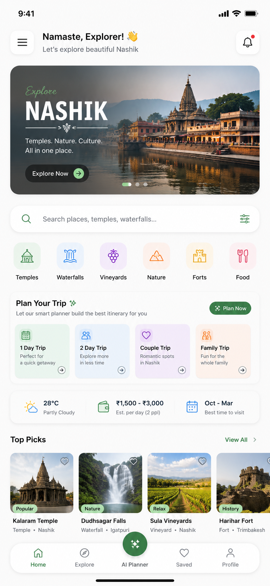

# Assets Catalog & Media Guide 🖼️📱

This guide documents every media asset copied into `docs/websitedetails/assets/`, along with production-grade HTML/CSS implementations for smartphone frames, logos, and responsive images.

---

## 1. Asset File Registry

All files are directly located in `docs/websitedetails/assets/`:

### 1.1 Branding & Logos (`./assets/branding/`)

| Filename | Format | File Size | Dimensions | Recommended Use Case |
| :--- | :--- | :--- | :--- | :--- |
| **`logo.png`** | PNG | `399 KB` | Square Transparent | Main navigation bar logo, footer branding, schema markup |
| **`app-horizontal-icon.png`** | PNG | `485 KB` | Landscape Wide | Social share preview (OG Image / Twitter Card), hero banner |
| **`trivio_horizontal_logo.jpg`** | JPG | `234 KB` | Wide Lockup | Email headers, partner media kits, press release banners |
| **`trivio_app_icon.webp`** | WebP| `125 KB` | Square Crisp | Fast-loading app icon for mobile views and cards |
| **`trivio_launcher_icon.png`** | PNG | `5.0 MB` | 1024×1024 Master | Master high-resolution app store artwork & print collateral |
| **`app-launcher-icon.png`** | PNG | `5.0 MB` | 1024×1024 | Web app icon and Google Play display badge |
| **`app-splashscreen-icon.png`**| PNG | `5.0 MB` | Master | Loading splashscreen graphic & animated brand intro |

### 1.2 Web & PWA Icons (`./assets/icons/`)

| Filename | Format | Dimensions | Recommended Use Case |
| :--- | :--- | :--- | :--- |
| **`favicon.png`** | PNG | `32×32 / 64×64` | Browser tab icon |
| **`Icon-192.png`** | PNG | `192×192` | Android home screen bookmark / PWA manifest |
| **`Icon-512.png`** | PNG | `512×512` | High-res PWA splash icon / Web manifest |
| **`Icon-maskable-192.png`** | PNG | `192×192` | Adaptive maskable icon for Android 13+ devices |
| **`Icon-maskable-512.png`** | PNG | `512×512` | High-density adaptive maskable icon |

### 1.3 Production App Screenshots (`./assets/screenshots/`)

| Filename | Format | File Size | Feature Shown | Screen Mapped |
| :--- | :--- | :--- | :--- | :--- |
| **`home.png`** | PNG | `1.51 MB` | Destination Home | Featured spots, weather widget, categories list |
| **`explore.png`** | PNG | `1.37 MB` | Search & Discovery | Universal search input, category chips, place cards |
| **`ai planner.png`** | PNG | `1.45 MB` | Smart Trip Planner | Multi-day timeline, Haversine transit, food slots |
| **`saved.png`** | PNG | `1.31 MB` | Wishlist Boards | Themed saved boards, offline sync status |
| **`profile.png`** | PNG | `1.08 MB` | Profile & Badges | Offline mode toggle, travel stats, reviews log |

---

## 2. Component Implementation Snippets

### 2.1 Responsive Navbar Logo Lockup

```html
<a href="/" class="flex items-center gap-3 group">
  
  <div class="flex flex-col">
    <span class="font-extrabold text-lg tracking-tight bg-gradient-to-r from-brand-blue to-brand-sky bg-clip-text text-transparent dark:from-white dark:to-brand-light">
      TRIVIO
    </span>
    <span class="text-[10px] uppercase font-bold tracking-widest text-slate-500 dark:text-slate-400 -mt-0.5">
      Travel Guide
    </span>
  </div>
</a>
```

### 2.2 Realistic Smartphone Mockup Component (HTML + Tailwind)

This component provides a sleek Android/iOS device bezel with curved corners, speaker grill notch, and dynamic screenshot swapper:

```html
<div class="relative w-[310px] sm:w-[330px] h-[640px] sm:h-[670px] bg-slate-900 rounded-[48px] p-3.5 shadow-2xl border-4 border-slate-700/60 ring-8 ring-slate-800 ring-offset-4 ring-offset-white dark:ring-offset-slate-950 overflow-hidden select-none">
  
  <!-- Speaker Grill / Camera Island -->
  <div class="absolute top-0 left-1/2 -translate-x-1/2 h-5 w-28 bg-slate-900 rounded-b-2xl z-30 flex items-center justify-center">
    <div class="h-1.5 w-10 bg-slate-700 rounded-full"></div>
  </div>
  
  <!-- Screen Area -->
  <div class="w-full h-full bg-slate-950 rounded-[36px] overflow-hidden relative shadow-inner">
    
  </div>
  
  <!-- Subtle Glass Glare Reflection -->
  <div class="absolute inset-0 bg-gradient-to-tr from-transparent via-white/5 to-white/10 pointer-events-none rounded-[48px]"></div>
</div>
```

### 2.3 Interactive Screenshot Swapper (JavaScript)

```javascript
// Switches phone screenshot when clicking feature cards
const phoneScreenImg = document.getElementById('active-phone-screen');
const featureItems = document.querySelectorAll('.feature-selector-item');

featureItems.forEach(item => {
  item.addEventListener('click', () => {
    // 1. Highlight active feature item
    featureItems.forEach(el => el.classList.remove('border-brand-sky', 'bg-brand-sky/10'));
    item.classList.add('border-brand-sky', 'bg-brand-sky/10');
    
    // 2. Cross-fade image smoothly
    const targetScreenshot = item.getAttribute('data-screenshot');
    if (targetScreenshot && phoneScreenImg) {
      phoneScreenImg.style.opacity = '0.3';
      setTimeout(() => {
        phoneScreenImg.src = targetScreenshot;
        phoneScreenImg.style.opacity = '1.0';
      }, 150);
    }
  });
});
```

---

## 3. Production Web Optimization Recommendations

Before deploying to production:

1. **Convert Large PNGs to WebP/AVIF:**
   The master launcher icons and screenshots are high-resolution PNGs (`1MB – 5MB`). For production web hosting, convert them to WebP (e.g. `cwebp -q 85 screenshot.png -o screenshot.webp`), reducing file size by up to **80%** without visible loss in sharpness.

2. **Responsive Image Tag (`<picture>`):**
```html
<picture>
  <source srcset="assets/screenshots/home.webp" type="image/webp">
  
</picture>
```
