# Visual-First Redesign for Nashik Travel Guide Web Presence

* **Author:** NashikExplore Engineering & Design
* **Status:** Approved
* **Date:** 2026-11-02
* **Target Package:** `com.sooubh.nashikexplore`
* **Canonical Site URL:** `https://nashik.sooubh.me`
* **Google Play Listing:** `https://play.google.com/store/apps/details?id=com.sooubh.nashikexplore`

--------------------------------------------------------------------------------

## Overview

The web presence for **Nashik Travel Guide** (`nashik.sooubh.me`) is the primary public entry point and conversion funnel for the production Android application (`com.sooubh.nashikexplore`). 

This project executes a visual-first redesign of the landing page, converting it from an unverified prototype into an authoritative marketing asset. The redesigned page highlights authentic destination photography (covering Trimbakeshwar, Sula Vineyards, and Sahyadri forts), showcases actual Android app screens inside realistic device frames, introduces fluid entrance motion, and provides structured navigation links to all mandatory Play Store compliance and legal documents.

### Brand & Nomenclature Conventions
* **Public Marketing Product:** **Nashik Travel Guide**
* **Developer Entity & Support Domain:** **NashikExplore** (`support@nashikexplore.com`)
* **Android Application Identifier:** `com.sooubh.nashikexplore`

## The Problem

The existing web implementation suffers from four structural flaws that diminish user trust and conversion:
1. **Brand Confusion & Broken Links:** The UI displays an unverified brand name ("Trivio") and links to an incorrect package identifier (`com.nashikexplore.app`) rather than the live Google Play listing (`com.sooubh.nashikexplore`).
2. **Synthetic Data and Policy Non-Compliance:** The presence of fictional reviews ("Pooja Deshmukh", "Vikramaditya Rathore") and synthetic 5-star ratings violates Google Play Store developer guidelines and contradicts the project's explicit anti-fabrication standards.
3. **Simulated Web Capabilities:** A 373-line simulated itinerary planner component (`TrivioPlannerTeaser.tsx`) mimics an in-browser planning tool using hardcoded mock states, confusing visitors and distracting from the primary goal of driving mobile app downloads.
4. **Visual Neglect:** Despite having high-resolution local photography and genuine Flutter app screenshots in the repository, the landing page relies on an anime meadow wallpaper (`hero-meadow.jpg`) displaying snowy alpine mountains that bear no resemblance to Nashik or the Western Ghats.

## Goals

* **Goal 1 (Unified Identity & Conversion):** Rebrand all landing page copy, schema markup, and metadata to **Nashik Travel Guide**, directing all installation buttons to `https://play.google.com/store/apps/details?id=com.sooubh.nashikexplore`.
* **Goal 2 (Truthful Representation):** Permanently remove `TrivioTestimonials.tsx` and `TrivioPlannerTeaser.tsx`, grounding all content in verified data from `src/data/nashikPlaces.ts` and authentic app capabilities.
* **Goal 3 (Visual-First Presentation):** Replace placeholder artwork with authentic Nashik photography (`public/images/destinations/`) and present real Android app screenshots (`public/images/screenshots/`) in mobile device frames.
* **Goal 4 (Accessible Motion):** Implement hardware-accelerated entrance motion (staggered typography and device entrance) using Framer Motion while strictly honoring `prefers-reduced-motion: reduce`.
* **Goal 5 (Site-Wide Navigation & Route Integrity):** Establish shared navigation headers and a multi-column footer linking all active routes (`/trip-planner`, `/delete-account`, `/data-safety`, `/privacy-policy`, `/terms-of-use`, `/disclaimer`, `/cookies-policy`, `/contact`), updating all consuming subpages.

## Non-Goals

* **Non-Goal 1:** Building an in-browser trip planner, route calculation engine, or web itinerary generator. (The existing `/trip-planner` route remains a static architectural feature dossier explaining the mobile app's AI itinerary feature).
* **Non-Goal 2:** Implementing user authentication, server-side bookmark synchronization, or web payment checkouts.
* **Non-Goal 3:** Generating synthetic AI artwork or hallucinatory depictions of heritage shrines and geographical trails.
* **Non-Goal 4:** Introducing heavy 3D canvas runtimes (Three.js/Spline) that degrade mobile device performance and battery life.

## Resolved Design Decisions (Formerly Open Questions)

* **Decision 1 (Hero Background):** Resolved in favor of a single preloaded high-resolution image (`public/images/destinations/sula-vineyards.jpg`). Cross-fading multiple hero images is rejected to strictly maintain Largest Contentful Paint (LCP) under 1.2s.
* **Decision 2 (Showcase Navigation):** Resolved in favor of accessible tab pill buttons. Touch swipe gesture interception on the phone chassis is rejected to eliminate mobile vertical scroll-trapping risks.
* **Decision 3 (Screenshot Selection):** Exclude `profile.png` (which displays a paid "Go Premium" banner) and enforce a strict 4-tab 1:1 mapping (`home.png`, `explore.png`, `ai-planner.png`, `saved.png`) to honor the "zero paywalls" value proposition.

## Critical User Journeys (CUJs)

### CUJ 1: Discovery to App Installation
* **Given:** A traveler searches for "Nashik trip guide" or "Trimbakeshwar timings" and lands on `nashik.sooubh.me`.
* **When:** The visitor scrolls past the hero, views the authentic destination gallery, and inspects the mobile app screenshot showcase.
* **Then:** The visitor taps "Get it on Google Play" and is redirected to `com.sooubh.nashikexplore` on the Google Play Store with zero broken redirects.

### CUJ 2: Compliance and Account Safety Navigation
* **Given:** A Google Play reviewer or existing app user visits the website to verify data safety or request account deletion.
* **When:** The user navigates to the footer.
* **Then:** Clear links to `/delete-account`, `/data-safety`, and `/privacy-policy` open the respective verified policy pages without 404 errors or layout breaks.

--------------------------------------------------------------------------------

## Technical Plan (Architecture)

### Architectural Diagram

```mermaid
flowchart TD
    subgraph Config [Single Source of Truth]
        CFG["src/config/site.ts<br/>(Package ID: com.sooubh.nashikexplore, URLs, Routes, Metadata)"]
    end

    subgraph Data [Verified Data & Media Assets]
        DATA["src/data/nashikPlaces.ts<br/>(Real coordinates, timings, distances, tips)"]
        DEST_IMG["public/images/destinations/<br/>(sula-vineyards.jpg, harihar-fort.jpg, etc.)"]
        APP_IMG["public/images/screenshots/<br/>(home.png, explore.png, ai-planner.png, saved.png)"]
    end

    subgraph GlobalComponents [src/components/]
        NAV["SiteNav.tsx<br/>(Shared floating glassmorphic nav)"]
        FOOTER["SiteFooter.tsx<br/>(Shared 3-column footer: App, Legal, Compliance)"]
    end

    subgraph LandingComponents [src/components/landing/]
        HERO["HeroSection.tsx<br/>(Cinematic photo + Framer Motion typography + Play Store CTA)"]
        SHOWCASE["AppShowcase.tsx<br/>(Device frame bezel + 4-tab authentic screenshot switcher)"]
        GALLERY["DestinationGallery.tsx<br/>(Editorial photo grid + category filters + station distances)"]
        ADVANTAGE["LocalAdvantage.tsx<br/>(Comparison: sanctum rules, 80° rock steps, offline Sahyadri maps)"]
        FAQ["AppFaq.tsx<br/>(Semantic HTML5 details/summary + FAQPage schema)"]
        CTA["DownloadCta.tsx<br/>(Final conversion banner with Google Play link)"]
    end

    CFG --> NAV & FOOTER & HERO & SHOWCASE & GALLERY & ADVANTAGE & FAQ & CTA
    DATA --> GALLERY
    DEST_IMG --> HERO & GALLERY
    APP_IMG --> SHOWCASE
```



### Component Hierarchy & Responsibilities

1. **`src/config/site.ts` (Single Source of Truth):**
   ```ts
   export interface SiteConfig {
     name: string;
     tagline: string;
     description: string;
     canonicalUrl: string;
     playStoreUrl: string;
     packageId: string;
     supportEmail: string;
     navLinks: Array<{ label: string; href: string }>;
     footerColumns: Array<{ title: string; links: Array<{ label: string; href: string; external?: boolean }> }>;
   }
   ```

2. **`SiteNav.tsx` & `SiteFooter.tsx` (Shared Navigation in `src/components/`):**
   - Hoisted into `src/components/` so all subpages (`LegalPageLayout.tsx`, `trip-planner/page.tsx`, `ContactClient.tsx`, `DeleteAccountClient.tsx`) share the exact same branded navigation and footer.
   - Comprehensive footer with 3 dedicated columns:
     - **App & Features:** `/trip-planner` (Feature Dossier), Google Play Store.
     - **Legal & Transparency:** `/privacy-policy`, `/terms-of-use`, `/disclaimer`, `/cookies-policy`.
     - **Account & Compliance:** `/delete-account`, `/data-safety`, `/contact`.

3. **`HeroSection.tsx` (`'use client'`, in `src/components/landing/`):**
   - Utilizes Next.js `<Image priority>` with authentic photography (`public/images/destinations/sula-vineyards.jpg`).
   - Uses `framer-motion` for smooth entrance reveals (`y: [20, 0]`, `opacity: [0, 1]`) conditioned on `prefers-reduced-motion`.
   - Dark gradient overlay (`from-slate-950/80 via-slate-950/40 to-transparent`) paired with `text-white font-bold drop-shadow-md` ensuring high legibility.
   - Primary high-contrast button pointing directly to `SITE_CONFIG.playStoreUrl`.

4. **`AppShowcase.tsx` (`'use client'`, in `src/components/landing/`):**
   - Renders a clean CSS/SVG smartphone bezel frame.
   - Embeds 4 core screenshots in strict 1:1 tab symmetry:
     1. `Home Overview` ➔ `public/images/screenshots/home.png`
     2. `Explore Nashik` ➔ `public/images/screenshots/explore.png`
     3. `AI Trip Planner` ➔ `public/images/screenshots/ai-planner.png`
     4. `Saved Wishlists` ➔ `public/images/screenshots/saved.png`
   - Default tab: `'explore'`. Tab clicks swap active image without full page reload.

5. **`DestinationGallery.tsx` (`'use client'`, in `src/components/landing/`):**
   - Consumes `NASHIK_REAL_PLACES` from `src/data/nashikPlaces.ts`.
   - Features rich editorial photo cards showing category badges (Heritage, Vineyard, Trek, Nature), distance from Nashik Road Railway Station, recommended arrival times, and one-tap external Google Maps links.

6. **`LocalAdvantage.tsx` (RSC, in `src/components/landing/`):**
   - Refactors the existing 5 comparison points (sanctum timings, vineyard booking slots, rock-step warnings, zero-backtracking sequencing, Sahyadri offline caching) comparing Nashik Travel Guide against generic national map applications.

7. **`AppFaq.tsx` (RSC, in `src/components/landing/`):**
   - Zero-JS semantic HTML5 `<details>` and `<summary>` elements with Tailwind `group-open:rotate-180`. 100% crawlable by search engines.

8. **`DownloadCta.tsx` (RSC, in `src/components/landing/`):**
   - Final high-contrast conversion banner with Google Play Store badge.

### Landing Page JSX Layout (`src/app/page.tsx`)
```tsx
export default function HomePage() {
  return (
    <>
      <script type="application/ld+json" dangerouslySetInnerHTML={{ __html: JSON.stringify(faqSchema) }} />
      <script type="application/ld+json" dangerouslySetInnerHTML={{ __html: JSON.stringify(spotsSchema) }} />
      <SiteNav />
      <main id="main-content">
        <HeroSection />
        <AppShowcase />
        <DestinationGallery />
        <LocalAdvantage />
        <AppFaq />
        <DownloadCta />
      </main>
      <SiteFooter />
    </>
  );
}
```

--------------------------------------------------------------------------------

## Alternatives Considered

### Alternative A: Retaining `TrivioPlannerTeaser.tsx` as a Read-Only Preview
* **Pros:** Keeps existing code intact without requiring deletion; displays mock itineraries directly on the page.
* **Cons:** At 373 lines of simulated client state, it adds dead weight to the bundle, creates visual clutter, and confuses visitors into thinking the web page is an in-browser planning tool rather than directing them to the Google Play app.
* **Reason for Rejection:** Contradicts the user's explicit directive to keep the landing page strictly informational without interactive web systems.

### Alternative B: Keeping Fictional Reviews with a Disclaimer
* **Pros:** Maintains social proof layout without creating gaps in the page flow.
* **Cons:** Fictional quotes ("Pooja Deshmukh", etc.) and fake 5-star ratings violate Google Play Store developer guidelines regarding deceptive representation. Disclaimers do not eliminate the risk of developer account suspension.
* **Reason for Rejection:** Integrity and policy compliance are non-negotiable. Real app screenshots inside phone frames provide superior, authentic proof of product capability.

### Alternative C: Generating Synthetic Destination Visuals via Generative AI
* **Pros:** Automated asset generation without manual photo curation.
* **Cons:** Generative AI models hallucinate architectural details of sacred temples (Trimbakeshwar), physical fort topography (Harihar's rock steps), and winery grounds, misleading pilgrims and trekkers.
* **Reason for Rejection:** The repository already possesses verified high-resolution photography in `public/images/destinations/`. Authentic local photography is vastly superior to synthetic AI hallucinations.

### Alternative D: Heavy 3D Graphics / Three.js / Spline Canvas
* **Pros:** Highly dynamic, trendy visual animations.
* **Cons:** Bloats JavaScript bundle by over 1.5MB gzip, causes severe thermal throttling and battery drain on mobile devices, and degrades Largest Contentful Paint (LCP) in rural Maharashtra areas with fluctuating cellular reception.
* **Reason for Rejection:** Violates Core Web Vitals performance budgets. High-craft CSS transitions and targeted Framer Motion effects achieve smooth visual polish at zero bundle bloat.

### Alternative E: Isolating Legal and Compliance Pages to Generic Unstyled Hyperlinks
* **Pros:** Minimizes footer design work.
* **Cons:** Fails Google Play Store developer requirements for transparent, accessible account deletion and data safety disclosure. Poorly accessible compliance pages risk app review rejections.
* **Reason for Rejection:** A structured 3-column footer ensures all compliance, privacy, and feature routes are permanently visible and properly indexed.

--------------------------------------------------------------------------------

## Non-Functional Requirements

* **Performance & Core Web Vitals:** Preload the hero image using `<Image priority fetchPriority="high" sizes="100vw" quality={85} />` to keep Largest Contentful Paint (LCP) under 1.2s. Enforce explicit aspect ratios on all cards and device bezels (`aspect-[9/19.5]`) to maintain Cumulative Layout Shift (CLS) at 0.00.
* **Accessibility:** All Framer Motion animations must observe `prefers-reduced-motion: reduce`. The skip-to-content anchor in `src/app/layout.tsx` must point to `href="#main-content"`.
* **Zero New Dependencies:** Strictly use existing dependencies (`next`, `framer-motion`, `tailwindcss`, `lucide-react`).

--------------------------------------------------------------------------------

## Detailed Implementation Plan

### Target Files to Create, Modify, and Delete

#### 1. `src/config/site.ts` (Create)
* **Type / Scope:** TypeScript Configuration Module
* **Proposed Changes:** Export `SiteConfig` interface and `SITE_CONFIG` object containing canonical title, tagline, description, canonical web domain (`https://nashik.sooubh.me`), support email, official Play Store URL (`com.sooubh.nashikexplore`), navigation link definitions, and 3-column footer link mappings.

#### 2. Shared Navigation (`src/components/SiteNav.tsx` & `src/components/SiteFooter.tsx`) (Create)
* **Type / Scope:** React Client & Server Components
* **Proposed Changes:** Build shared navigation and footer components consuming `SITE_CONFIG`.

#### 3. `src/components/landing/HeroSection.tsx` (Create - `'use client'`)
* **Type / Scope:** React Client Component
* **Proposed Changes:** Implement cinematic hero header using `public/images/destinations/sula-vineyards.jpg` via Next.js `<Image priority sizes="100vw" />`. Integrate Framer Motion fade-up animations on headline, feature badge, and Google Play install button.

#### 4. `src/components/landing/AppShowcase.tsx` (Create - `'use client'`)
* **Type / Scope:** React Client Component
* **Proposed Changes:** Build responsive smartphone bezel frame in SVG/CSS embedding genuine screenshots from `public/images/screenshots/` (`home.png`, `explore.png`, `ai-planner.png`, `saved.png`). Provide an interactive feature tab bar allowing visitors to cycle through screens.

#### 5. `src/components/landing/DestinationGallery.tsx` (Create - `'use client'`)
* **Type / Scope:** React Client Component
* **Proposed Changes:** Import `NASHIK_REAL_PLACES` from `src/data/nashikPlaces.ts`. Render editorial destination cards featuring authentic images (`trimbakeshwar-temple.jpg`, `sula-vineyards.jpg`, `harihar-fort.jpg`, `someshwar-waterfall.jpg`), category tags, distance from Nashik Road station, and direct Google Maps coordinate links.

#### 6. `src/components/landing/LocalAdvantage.tsx` (Create - RSC)
* **Type / Scope:** React Server Component
* **Proposed Changes:** Rebrand the 5 comparison dimensions (Sanctum pass hours, vineyard cellar slots, rock-step hazards, route clustering, Sahyadri offline caching) comparing Nashik Travel Guide against generic map tools.

#### 7. `src/components/landing/AppFaq.tsx` (Create - RSC)
* **Type / Scope:** React Server Component
* **Proposed Changes:** Render accessible HTML5 `<details>` and `<summary>` FAQ accordion covering offline caching, zero paywalls, GPS navigation handoff, and temple guidelines.

#### 8. `src/components/landing/DownloadCta.tsx` (Create - RSC)
* **Type / Scope:** React Server Component
* **Proposed Changes:** Final high-contrast conversion section with Google Play badge and download prompt linking to `com.sooubh.nashikexplore`.

#### 9. Subpage Layout & Client Updates (Modify)
* **`src/components/LegalPageLayout.tsx`**: Update imports from `@/components/trivio/TrivioNav` and `TrivioFooter` to `@/components/SiteNav` and `@/components/SiteFooter`.
* **`src/app/trip-planner/page.tsx`**: Update imports to `@/components/SiteNav` and `@/components/SiteFooter`, rebrand all copy to Nashik Travel Guide, and update the store download link to `com.sooubh.nashikexplore`.
* **`src/components/Contact/ContactClient.tsx`**: Update navigation/footer imports to `@/components/SiteNav` and `@/components/SiteFooter`.
* **`src/components/DeleteAccount/DeleteAccountClient.tsx`**: Update navigation/footer imports to `@/components/SiteNav` and `@/components/SiteFooter`, and update Play Store references to `com.sooubh.nashikexplore`.

#### 10. `src/app/page.tsx` (Modify)
* **Type / Scope:** Next.js App Router Page
* **Proposed Changes:** Mount the exact layout tree with `<main id="main-content">`, `<SiteNav />`, `<HeroSection />`, `<AppShowcase />`, `<DestinationGallery />`, `<LocalAdvantage />`, `<AppFaq />`, `<DownloadCta />`, `<SiteFooter />`. Update JSON-LD `FAQPage` and `ItemList` schemas.

#### 11. `src/app/layout.tsx` (Modify)
* **Type / Scope:** Next.js Root Layout
* **Proposed Changes:** Retarget skip link to `href="#main-content"`. Update `metadata` and JSON-LD `MobileApplication` schema to reflect `SITE_CONFIG` values and `com.sooubh.nashikexplore`.

#### 12. Complete Deletion of Deprecated / Synthetic Files (Delete)
* `src/components/trivio/TrivioTestimonials.tsx` (Delete: fake reviews and ratings).
* `src/components/trivio/TrivioPlannerTeaser.tsx` (Delete: 373-line simulated itinerary generator).
* `src/components/trivio/TrivioJourney.tsx` (Delete: legacy onboarding flow).
* `src/components/trivio/TrivioCategories.tsx` (Delete: replaced by DestinationGallery).
* `src/components/trivio/TrivioFounderNote.tsx` (Delete: placeholder note).
* `src/components/trivio/TrivioHero.tsx` (Delete: replaced by HeroSection).
* `src/components/trivio/TrivioSpots.tsx` (Delete: replaced by DestinationGallery).
* `src/components/trivio/TrivioFeatures.tsx` (Delete: replaced by AppShowcase).
* `src/components/trivio/TrivioComparison.tsx` (Delete: replaced by LocalAdvantage).
* `src/components/trivio/TrivioNav.tsx` (Delete: replaced by SiteNav).
* `src/components/trivio/TrivioFooter.tsx` (Delete: replaced by SiteFooter).
* `src/components/trivio/TrivioCta.tsx` (Delete: replaced by DownloadCta).
* `src/components/trivio/TrivioFaq.tsx` (Delete: replaced by AppFaq).

#### 13. `README.md` (Modify)
* **Type / Scope:** Repository Documentation
* **Proposed Changes:** Update branding and route tables to reflect the new architecture, confirmed package ID `com.sooubh.nashikexplore`, and updated component inventory.

### Verification Plan

* **Compilation & Build:** Run `npm run build` to confirm zero TypeScript compilation errors, zero missing import errors, and clean static page generation across all routes.
* **Linting:** Run `npm run lint` to enforce ESLint and Next.js rule compliance.
* **Accessibility & Reduced Motion:** Run `git grep -n "useReducedMotion" src/components/landing/` to verify motion guards. Confirm `#main-content` skip link works with keyboard tab navigation.
* **Layout Stability (CLS):** Verify that all images and smartphone bezels specify explicit aspect ratios to guarantee a Cumulative Layout Shift score of 0.00.
* **Route Integrity:** Run an automated status check across all routes (`/`, `/trip-planner`, `/delete-account`, `/data-safety`, `/privacy-policy`, `/terms-of-use`, `/disclaimer`, `/cookies-policy`, `/contact`) to verify 200 HTTP responses.

--------------------------------------------------------------------------------

*Drafted with EGM*
