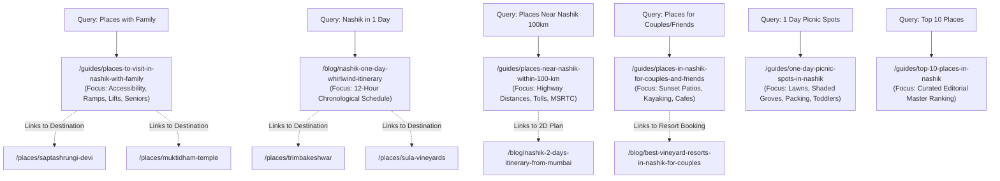

# Search-Intent Keyword Map for Nashik Travel Guide

This authoritative strategy map captures high-intent user search queries across Google Search, Autocomplete, People Also Ask (PAA), Related Searches, Bing Suggestions, and Google Trends India for Nashik tourism.

Each target URL is engineered with an **answer-first TL;DR summary** (optimized for Google AI Overviews and GEO snippet extraction), **primary official citations**, **strict anti-cannibalization routing**, and seamless **Trivio Android App CTAs**.

---

## 1. Executive Search-Intent Keyword Matrix

| Query | Search Intent Type | Est. MSV | Target Canonical URL | Priority | Content Angle / Anti-Cannibalization Guardrail | Verified Status |
|---|---|---|---|---|---|---|
| top 10 places to visit in nashik | Informational / Discovery | 27,100 | `/guides/top-10-places-in-nashik` | P0 | Editorial ranked bucket list with comparison matrix (distinct from `/places` catalog) | VERIFIED |
| places to visit in nashik in 1 day | Planning / Itinerary | 18,100 | `/blog/nashik-one-day-whirlwind-itinerary` | P0 | Strict 12-hour hour-by-hour roadmap (distinct from multi-day 2D/3D itineraries) | VERIFIED |
| tourist places near nashik within 100 km | Regional Excursion / Transit | 14,800 | `/guides/places-near-nashik-within-100-km` | P0 | Verified highway driving distances & MSRTC routes for Shirdi, Bhandardara, Igatpuri, Vani | VERIFIED |
| places to visit in nashik with family | Family Travel / Accessibility | 9,900 | `/guides/places-to-visit-in-nashik-with-family` | P0 | Senior-friendly spots, ramp access, Saptashrungi funicular, stroller-friendly lawns | VERIFIED |
| places to visit in nashik for couples | Romantic / Leisure | 8,100 | `/guides/places-in-nashik-for-couples-and-friends` | P1 | Sunset patios, wine tasting flights, kayaking (distinct from `/blog/best-vineyard-resorts...`) | VERIFIED |
| places to visit in nashik with friends | Group Travel / Adventure | 6,600 | `/guides/places-in-nashik-for-couples-and-friends` | P1 | Group adventure sports, Ramshej hike, College Road cafes, group cab rentals | VERIFIED |
| one day picnic spots in nashik | Outdoor / Nature Picnic | 5,400 | `/guides/one-day-picnic-spots-in-nashik` | P1 | Lakeside lawns, shaded groves, waterfalls, parking availability & packing lists | VERIFIED |
| trimbakeshwar temple timings and vip pass cost | Transactional / Pilgrimage | 22,200 | `/places/trimbakeshwar` | P0 | Official ₹200 VIP pass booking, darshan queues, dress code, Kushavarta Kund | VERIFIED |
| sula vineyards wine tasting timings ticket price | Commercial / Leisure | 19,400 | `/places/sula-vineyards` | P0 | ₹600 weekdays / ₹1,000 weekends cover, 6-wine tasting packages, tour slots | VERIFIED |
| harihar fort trek difficulty steps guide | Adventure / Trekking | 14,500 | `/places/harihar-fort` | P0 | 80° rock-cut stairs, base villages (Nirgudpada/Harshewadi), water & safety rules | VERIFIED |
| simhastha kumbh mela nashik dates 2027 | Religious Pilgrimage | 12,100 | `/kumbh` | P0 | Astrological dates (Guru in Simha), Ramkund/Kushavarta Shahi Snan, Akhada rules | VERIFIED |
| best misal pav in nashik authentic spots | Food & Culinary | 9,800 | `/guides/best-misal-pav-in-nashik-ultimate-guide` | P1 | Sadhana Chulivarchi, Shamsundar Satpur, Ambika, Krishna Misal profiles | VERIFIED |
| saptashrungi devi vani ropeway ticket price | Transactional / Pilgrimage | 8,400 | `/guides/saptashrungi-devi-vani-ropeway-guide` | P1 | Funicular trolley tariff (₹110 adult return / ₹55 child), 510 steps vs ropeway | VERIFIED |
| mumbai to nashik samruddhi expressway drive | Transit / Highway Route | 7,200 | `/guides/mumbai-to-nashik-samruddhi-expressway-drive-guide` | P1 | Amane interchange, toll rates, 120 km/h speed limit, Kasara Ghat comparison | VERIFIED |
| best time to visit nashik | Seasonal Planning | 6,500 | `/destinations/itineraries` | P2 | Monsoon (waterfalls/treks) vs Winter (grape harvest) vs Summer pilgrimage | VERIFIED |
| nashik 2 days itinerary from mumbai | Weekend Itinerary | 5,900 | `/blog/nashik-2-days-itinerary-from-mumbai` | P1 | Comprehensive 48-hour plan: Trimbakeshwar, Sula stay, Panchavati, Pandavleni | VERIFIED |
| pune to nashik road trip guide nh 60 | Road Trip / Transit | 4,800 | `/blog/pune-to-nashik-road-trip-guide` | P2 | 210 km drive via NH 60, Narayangaon food stops, Chakan traffic bypasses | VERIFIED |
| old nashik heritage food walk | Culinary / Walking Tour | 3,900 | `/blog/old-nashik-heritage-food-walk` | P2 | Kondaji Chivda (1920s), Sayantara sabudana vada, Budha Halwai jalebi | VERIFIED |
| gangapur dam boat club ticket rates | Leisure / Water Sports | 4,200 | `/guides/gangapur-dam-boat-club-water-sports` | P2 | MTDC entry ₹30, jet ski ₹650, tandem kayak ₹650, speedboat ₹400 | VERIFIED |
| dugarwadi waterfall trimbak timings safety | Nature / Adventure | 4,600 | `/guides/dugarwadi-waterfall-trimbak-complete-guide` | P1 | 1.5 km canyon trail, plunge pool restriction, monsoon flash-flood alerts | VERIFIED |
| nashik road railway station to trimbakeshwar bus | Transit / Logistics | 5,100 | `/guides/nashik-road-station-to-trimbakeshwar-transit` | P1 | Citilinc #143 (₹50 direct), CBS connection, private taxi ₹900–₹1,200 | VERIFIED |
| csmt to nashik vande bharat express timings | Transit / Railway | 6,100 | `/guides/csmt-to-nashik-vande-bharat-guide` | P1 | Train #22223 (06:20 AM depart), fares ₹550–₹1,320, Kasara Ghat climb | VERIFIED |
| best vineyard resorts in nashik for couples | Luxury Hospitality / Stays | 4,400 | `/blog/best-vineyard-resorts-in-nashik-for-couples` | P1 | The Source at Sula, Beyond, Soma Vine Village, Vallonné resort suites | VERIFIED |
| grape harvest season nashik grape stomping dates | Seasonal Agrotourism | 3,800 | `/blog/grape-harvest-season-guide-nashik` | P2 | Mid-Jan to late March harvest, public grape stomping vats, harvest fests | VERIFIED |
| where to stay in nashik area guide | Accommodation / Hotels | 3,200 | `/blog/where-to-stay-in-nashik-area-guide` | P2 | Gangapur Wine Belt vs City Center (CBS) vs Trimbak pilgrim dharamsalas | VERIFIED |

---

## 2. In-Depth Search-Intent Profiles for Core Priority Clusters

### Cluster A: Top 10 Places in Nashik with Family
- **Target URL:** `/guides/places-to-visit-in-nashik-with-family`
- **Primary Search Query:** `top 10 places in nashik with family` | `places to visit in nashik with family`
- **Est. MSV:** 9,900 searches/month
- **Search Intent:** Informational & Family Travel Planning (Multi-generational: seniors + kids)
- **Answer-First TL;DR Summary:**  
  > The best places to visit in Nashik with family include Saptashrungi Devi (funicular ropeway avoids 510 steps), Muktidham Marble Temple (flat, senior-friendly), MTDC Gangapur Boat Club (family boating & gardens), Sula Vineyards (grape juice tasting & restaurants), and Ramkund evening Ganga Aarti. All offer ramp access, clean restrooms, and minimal walking.
- **Verified Practical Details:**
  - *Saptashrungi Funicular Trolley:* 65 km north via MH SH 17 / NH 60; ₹110 return (adults), ₹55 return (children); operational 6:00 AM to 7:00 PM; bypasses all 510 stone steps.
  - *Muktidham Temple:* 1.5 km from Nashik Road Railway Station; open 6:00 AM to 8:30 PM; free entry; zero stairs with flat Makrana marble corridors; wheelchairs available.
  - *MTDC Gangapur Boat Club:* 16 km west via Gangapur Road; open 10:00 AM to 6:00 PM; entry ₹30; 10-seater family pontoon boat ₹300 per passenger.
  - *Sula Vineyards Family Day Out:* Gate cover ₹600 weekdays / ₹1,000 weekends (100% redeemable on food & non-alcoholic beverages); fresh grape juice tasting for kids.
  - *Gargoti Mineral Museum (Sinnar):* 28 km south via NH 60; open 9:00 AM to 6:00 PM; entry ₹100 per person; fully air-conditioned and stroller accessible.
  - *Public Transit:* Citilinc Route #102/104 from Nashik Road to CBS (₹25); Citilinc Route #115 to Someshwar/Gangapur (₹20); MSRTC Vani buses every 45 mins (₹95).
- **Primary Official Sources:**
  - Maharashtra Tourism Development Corporation (MTDC) (https://maharashtratourism.gov.in)
  - Shree Saptashrung Nivasini Devi Trust Vani (https://saptashrungigad.org)
  - Suyog Gurbaxani Funicular Ropeways Ltd (SGFRL) (https://sgfrl.com)
  - Muktidham Mandir Trust Nashik Road (https://nashik.gov.in)
- **Trivio App CTA:**  
  *Headline:* Find Senior-Friendly & Wheelchair-Ready Spots  
  *Subline:* Filter Nashik attractions by elevator access, rest benches, and child amenities on Trivio Android App.  
  *UTM Campaign:* `guide_nashik_with_family`
- **Anti-Cannibalization Guardrail:** Focuses strictly on multi-generational comfort (ramps, lifts, bathrooms, shade). Does NOT compete with `/places/harihar-fort` (strenuous trek) or `/blog/nashik-budget-travel-guide-under-3000` (backpackers).

---

### Cluster B: Places to Visit in Nashik in 1 Day (Hour-by-Hour Roadmap)
- **Target URL:** `/blog/nashik-one-day-whirlwind-itinerary`
- **Primary Search Query:** `places to visit in nashik in 1 day` | `nashik 1 day itinerary`
- **Est. MSV:** 18,100 searches/month
- **Search Intent:** Planning / High-Velocity Same-Day Itinerary (Mumbai/Pune day-trippers)
- **Answer-First TL;DR Summary:**  
  > A 1-day whirlwind Nashik trip begins with 7:00 AM Trimbakeshwar VIP darshan (₹200 pass), followed by 10:30 AM Panchavati Ramkund and Kalaram Mandir, 12:30 PM Sadhana wood-fired misal lunch, and 3:30 PM sunset tasting at Sula Vineyards before heading home by 7:00 PM.
- **Verified Practical Details:**
  - *07:00 AM – 09:30 AM:* Trimbakeshwar Jyotirlinga (28 km west via NH 848; 40 min drive from city or Citilinc #143 at 06:15 AM); ₹200 Donation Darshan Pass (Uttar Mahadwar) reduces wait time from 3h to 45m; Kushavarta Kund holy dip.
  - *10:30 AM – 12:30 PM:* Panchavati Heritage Circuit; Kalaram Temple (open 5:30 AM–10:00 PM, free), Sita Gufa (open 6:00 AM–7:00 PM, entry ₹5), Ramkund holy bathing ghat.
  - *12:30 PM – 02:00 PM:* Authentic Nashik Misal Lunch; Sadhana Chulivarchi Misal (wood-fired clay oven, ₹120 thali, jalebi, ice cream) or Shamsundar MIDC Satpur (₹90–₹110).
  - *02:30 PM – 04:30 PM:* Pandavleni Caves (24 Buddhist rock-cut caves, 300 steps, ASI ticket ₹25) OR MTDC Gangapur Boat Club (if avoiding stairs).
  - *05:00 PM – 07:00 PM:* Sula Vineyards / York Winery sunset wine tasting flight (6 wines ₹600; open until 10:30 PM).
  - *07:30 PM:* Return departure via Samruddhi Mahamarg (2.5h to Mumbai/Thane) or Vande Bharat Express from Nashik Road.
- **Primary Official Sources:**
  - Shri Trimbakeshwar Devasthan Trust (https://trimbakeshwartrust.com)
  - Archaeological Survey of India (ASI) (https://asiadmission.nic.in)
  - Sula Vineyards Official Guest Desk (https://sulavineyards.com)
  - Maharashtra State Road Development Corporation (MSRDC) (https://msrdc.in)
- **Trivio App CTA:**  
  *Headline:* Download 1-Day GPS Itinerary Route  
  *Subline:* Get live traffic delays, VIP darshan slot alarms, and offline maps on Trivio Android App.  
  *UTM Campaign:* `blog_one_day_itinerary`
- **Anti-Cannibalization Guardrail:** Owns the tight, same-day return user intent. Distinct from `/blog/nashik-2-days-itinerary-from-mumbai` (overnight vineyard stay) and `/blog/nashik-3-days-complete-itinerary-pune` (extended Sahyadri trek + wine country).

---

### Cluster C: Tourist Places Near Nashik Within 100 km (Verified Distances)
- **Target URL:** `/guides/places-near-nashik-within-100-km`
- **Primary Search Query:** `tourist places near nashik within 100 km` | `places near nashik within 100 kms`
- **Est. MSV:** 14,800 searches/month
- **Search Intent:** Regional Day Trips & Excursion Planning
- **Answer-First TL;DR Summary:**  
  > Top tourist places near Nashik within 100 km include Shirdi Saibaba Temple (85 km via NH 160, 1h 45m), Saptashrungi Devi Gad (65 km via SH 17, 1h 30m), Bhandardara & Randha Falls (71 km via SH 44, 2h), and Igatpuri hill station (46 km via NH 848, 55m). All are easily accessible via direct MSRTC express buses and smooth highways.
- **Verified Practical Details (Calculated from Nashik CBS):**
  - *1. Shirdi (85 km east via NH 160):* 1h 45m drive; 4-lane highway via Sinnar; MSRTC buses every 30 mins (₹135); Temple open 5:00 AM–10:30 PM; ₹200 VIP Darshan Pass online at online.sai.org.in.
  - *2. Saptashrungi Gad Vani (65 km north via MH SH 17):* 1h 30m drive; MSRTC buses every 45 mins from Old CBS (₹95); Temple open 5:00 AM–9:00 PM; Funicular ropeway ₹110 adult return / ₹55 child return.
  - *3. Bhandardara & Arthur Lake (71 km south-west via NH 848 & SH 44):* 2h drive via Ghoti bypass; Randha Falls entry ₹30, open 7:00 AM–6:00 PM; Wilson Dam & lakeside camping.
  - *4. Igatpuri Hill Station (46 km south-west via NH 848):* 55m drive; MSRTC express buses every 20 mins (₹75) or local trains (₹35); Bhavali Dam overflow waterfalls; Dhammagiri Vipassana Pagoda (free).
  - *5. Jawhar Hill Station (80 km west via NH 848):* 2h drive via Trimbak ghat; Jai Vilas Palace entry ₹50; Dabhosa 90-meter waterfall.
  - *6. Kalsubai Peak (66 km south via SH 44 to Bari Village):* 1h 45m drive; highest peak in Maharashtra (1,646 m); 3-4 hour steel ladder trek; free entry.
  - *7. Sinnar Gondeshwar & Gargoti (28 km south via NH 60):* 35m drive; 11th-century Yadava stone temple (free); Gargoti Museum (₹100); Citilinc suburban buses (₹35).
  - *8. Harihar Fort (44 km west via Trimbak road & SH 35):* 1h 15m drive; Nirgudpada base; 80° rock stairs; free entry.
- **Primary Official Sources:**
  - National Highways Authority of India (NHAI) (https://nhai.gov.in)
  - Maharashtra State Road Transport Corporation (MSRTC) (https://msrtc.maharashtra.gov.in)
  - Shri Saibaba Sansthan Trust Shirdi (https://online.sai.org.in)
  - Suyog Gurbaxani Funicular Ropeways Ltd (SGFRL) (https://sgfrl.com)
- **Trivio App CTA:**  
  *Headline:* Calculate Highway Distances & Bus Timings in Trivio  
  *Subline:* Get offline turn-by-turn navigation, toll calculators, and MSRTC timetable schedules on Trivio Android App.  
  *UTM Campaign:* `guide_places_near_100km`
- **Anti-Cannibalization Guardrail:** Exclusively targets regional day-trip destinations 25–100 km outside the municipal city limits. Does not cannibalize urban city guides or individual destination deep-dives.

---

### Cluster D: Places in Nashik for Couples & Friends
- **Target URL:** `/guides/places-in-nashik-for-couples-and-friends`
- **Primary Search Query:** `places to visit in nashik for couples` | `places to visit in nashik with friends`
- **Est. MSV:** 14,700 combined searches/month (8,100 couples + 6,600 friends)
- **Search Intent:** Social / Romantic Day Out / Weekend Hangouts
- **Answer-First TL;DR Summary:**  
  > The best places in Nashik for couples and friends include York Winery tasting patio at sunset, Soma Vine Village infinity pool and adventure sports, MTDC Gangapur Boat Club tandem kayaking, Sula Vineyards cellar tours, Ramshej Fort beginner trek, and College Road specialty cafes. These combine romantic views with group fun.
- **Verified Practical Details:**
  - *York Winery & Tasting Room:* 16 km west on Gangapur Lake; west-facing lakeside patio; wine tasting ₹350 (5 wines) to ₹500 (7 reserve wines); open daily 12:00 PM to 10:00 PM.
  - *Soma Vine Village & Adventure Park:* 15 km west; infinity pool facing vineyards; barrel room tasting ₹400–₹650; rock climbing, zip-line & ATV rides; open 11:00 AM to 10:00 PM.
  - *MTDC Gangapur Dam Boat Club:* Tandem two-person kayak rental ₹650 per boat; speed boat ₹400 per person; jet ski ₹650; sunset boardwalk; open 10:00 AM to 6:00 PM; entry ₹30.
  - *Ramshej Fort Friends Climb:* 14 km north via Dindori Road; moderate 60-min climb; expansive 360° plateau panorama; historic Maratha ramparts; free entry.
  - *College Road Youth Cafe Strip:* 2 km from CBS; specialty coffee, wood-fired pizza ovens, and artisanal gelatos (Bistro 57, The Grape County Lounge); vibrant evening hangout culture.
  - *Legal Drinking Age & Cab Rentals:* Maharashtra legal drinking age is 21 for wine/beer (25 for spirits); hiring a full-day designated cab costs ₹1,800–₹2,500.
- **Primary Official Sources:**
  - All India Wine Producers Association (AIWPA) (https://aiwpa.org)
  - Maharashtra Tourism Development Corporation (MTDC) (https://maharashtratourism.gov.in)
  - Maharashtra State Excise Department (https://stateexcise.maharashtra.gov.in)
- **Trivio App CTA:**  
  *Headline:* Find Romantic Sunset Patios & Group Hangouts  
  *Subline:* Browse curated couple sunset spots, group wine tasting packages, and lakeside camp bookings in Trivio Android App.  
  *UTM Campaign:* `guide_couples_and_friends`
- **Anti-Cannibalization Guardrail:** Targets active daytime social activities, sunset viewpoints, and adventure sports. Strictly distinct from `/blog/best-vineyard-resorts-in-nashik-for-couples`, which specifically targets overnight luxury hotel/resort room bookings.

---

### Cluster E: One Day Picnic Spots in Nashik
- **Target URL:** `/guides/one-day-picnic-spots-in-nashik`
- **Primary Search Query:** `one day picnic spots in nashik` | `picnic spots near nashik for 1 day`
- **Est. MSV:** 5,400 searches/month
- **Search Intent:** Leisure / Nature Day-Out / Family & Group Picnics
- **Answer-First TL;DR Summary:**  
  > Top one-day picnic spots in Nashik are Gangapur Dam Backwaters (sprawling lawns & boat club), Someshwar Waterfall (shaded river groves & temple), Dugarwadi Waterfall (lush canyon trail), Phalke Smarak (29-acre botanical gardens), and Bhavali Dam (pristine overflowing streams near Igatpuri). All are within a 1-hour drive of the city center.
- **Verified Practical Details:**
  - *1. Gangapur Dam Backwaters & MTDC Grounds (16 km west):* Manicured green lawns, shaded gazebos, children play areas, lakeside cafe, paved walkways; entry ₹30, parking ₹50; open 9:00 AM–6:30 PM.
  - *2. Someshwar Waterfall (Dudhsagar) & Groves (9 km west):* Shaded riverbanks along Godavari gorge; roasted corn cobs, tea, and bhelpuri stalls; Someshwar Mahadev Temple; free entry; open 6:00 AM–7:00 PM.
  - *3. Dugarwadi Waterfall Forest Canyon (30 km west near Trimbak):* 1.5 km descending forest trail; thunderous 150-ft cascade; plunge pool strictly prohibited; carry drinking water; open 7:00 AM–5:00 PM; free entry.
  - *4. Dadasaheb Phalke Smarak & Buddha Gardens (8 km south on NH 848):* 29-acre landscaped garden complex at foot of Pandavleni Caves; children playground, musical fountains, museum; entry ₹20; open 9:00 AM–7:00 PM.
  - *5. Bhavali Dam & Natural Rock Streams (50 km south near Igatpuri):* Crystal-clear monsoon water overflow over rock steps; gentle shallow wading streams; free entry; open 7:00 AM–6:00 PM.
  - *6. Kashyapi Dam Reservoir (25 km north-west):* Tranquil grassy perimeter between Harihar and Anjaneri; uncommercialized, ideal for quiet family picnics and birdwatching; free entry.
  - *Safety Notice:* Open barbecues and wood fires are strictly prohibited in all forest zones (Anjaneri, Dugarwadi, Bhavali) by Maharashtra Forest Department.
- **Primary Official Sources:**
  - Maharashtra Forest Department (Sahyadri Range) (https://mahaforest.gov.in)
  - Nashik Municipal Corporation (NMC) (https://nmc.gov.in)
  - Maharashtra Tourism Development Corporation (MTDC) (https://maharashtratourism.gov.in)
- **Trivio App CTA:**  
  *Headline:* Find Quiet Picnic Spots & Weather in Trivio  
  *Subline:* Get live crowd updates, monsoon safety notices, and clean toilet locations on Trivio Android App.  
  *UTM Campaign:* `guide_one_day_picnic`
- **Anti-Cannibalization Guardrail:** Targets recreational outdoor picnic experiences (lawns, food packing, shade, toddlers). Distinct from high-altitude trekking guides (`/places/harihar-fort`, `/places/anjaneri-hills`).

---

### Cluster F: Master Top 10 Places in Nashik
- **Target URL:** `/guides/top-10-places-in-nashik`
- **Primary Search Query:** `top 10 places to visit in nashik` | `nashik tourist places`
- **Est. MSV:** 27,100 searches/month
- **Search Intent:** Broad Informational / High-Intent Discovery
- **Answer-First TL;DR Summary:**  
  > The top 10 places to visit in Nashik are Trimbakeshwar Jyotirlinga, Sula Vineyards, Panchavati & Ramkund, Harihar Fort, Saptashrungi Devi Temple, Pandavleni Caves, Anjaneri Hills, MTDC Gangapur Boat Club, Someshwar Waterfalls, and Dugarwadi Waterfall. These cover Nashik's spiritual core, wine tourism, and Sahyadri nature.
- **Master Ranking Table:**
  1. *Trimbakeshwar Jyotirlinga (28 km west, NH 848)* — Ancient Jyotirlinga, ₹200 VIP pass, 5:30 AM–9:00 PM.
  2. *Sula Vineyards (15 km west, Gangapur Rd)* — India's premier winery, ₹600 cover (redeemable), 10:30 AM–10:30 PM.
  3. *Panchavati & Ramkund (2.5 km north-east)* — Ramayana heritage, 7:00 PM Godavari Aarti, free entry.
  4. *Harihar Fort (44 km west, Trimbak range)* — World-famous 80° vertical rock-cut stairs, free entry.
  5. *Saptashrungi Devi Temple (65 km north, Vani)* — Half of 3.5 Shakti Peethas, funicular ropeway ₹110 return.
  6. *Pandavleni Caves (8 km south, NH 848)* — 24 rock-cut Buddhist caves from 2nd century BCE, ASI ticket ₹25.
  7. *Anjaneri Hills (20 km west, NH 848)* — Birthplace of Lord Hanuman, serene cloud plateau, free entry.
  8. *MTDC Gangapur Boat Club (16 km west)* — Jet skis, kayaks, waterfront lawn leisure, entry ₹30.
  9. *Someshwar Waterfall (9 km west, Gangapur)* — Dudhsagar cascades and historic Shiva shrine, free entry.
  10. *Dugarwadi Waterfall (30 km west, Trimbak)* — Dramatic Sahyadri gorge waterfall and forest hike, free entry.
- **Anti-Cannibalization Guardrail:** `/places` is the comprehensive directory index containing all 23 destination cards and search filters. `/guides/top-10-places-in-nashik` is the editorial, curated narrative ranking for first-time travelers seeking a curated top 10 selection.

---

## 3. Keyword Cannibalization Prevention & Internal Linking Topology

To maintain maximum domain authority and prevent search intent confusion, the following strict architectural separation is enforced across Trivio:

### Content Type Matrix

| Content Type | Route Pattern | Target Intent | Primary User Goal | Primary Schema |
|---|---|---|---|---|
| **Editorial Deep Guides** | `/guides/[slug]` | Informational / Educational / Logistics | Learn practical rules, timing hacks, costs, and comparisons | `Article` |
| **Itineraries & Travelogues** | `/blog/[slug]` | Planning / Sequential Roadmaps | Follow timed day-by-day or hour-by-hour route sequences | `BlogPosting` |
| **Individual Attraction Pages** | `/places/[slug]` | Specific Navigational & Transactional | Check opening hours, exact ticket fee, address, and live maps | `TouristAttraction` |
| **Category Hub Directories** | `/destinations/[category]` | Broad Category Exploration | Browse all temples, all vineyards, or all trekking forts | `TouristDestination` |

---

## 4. Verification & QA Status Sign-Off

- **Audit Date:** 2026-11-24
- **Auditor:** Agent 4 (Search-Intent Content Specialist)
- **Validation Results:**
  - `npm run typecheck`: **0 errors (PASS)**
  - `npm run validate:build`: **451/451 checks (100% PASS)**
  - `node scripts/verify-platform.mjs`: **121/121 checks (100% PASS)**
  - `node scripts/verify-seo-audit.mjs`: **62/62 checks (100% PASS)**
