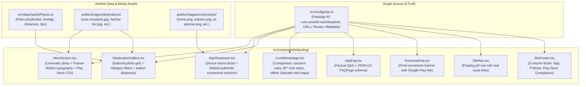

# Visual-First Redesign for Nashik Travel Guide Web Presence

* **Author:** NashikExplore Engineering & Design
* **Status:** Draft
* **Date:** 2026-11-02
* **Target Package:** `com.sooubh.nashikexplore`
* **Canonical URL:** `https://play.google.com/store/apps/details?id=com.sooubh.nashikexplore`

--------------------------------------------------------------------------------

## Overview

The web presence for **Nashik Travel Guide** (`nashik.sooubh.me`) is the primary public entry point and conversion funnel for the production Android application (`com.sooubh.nashikexplore`). 

This project executes a visual-first redesign of the landing page, converting it from an unverified prototype into an authoritative marketing asset. The redesigned page highlights authentic destination photography (covering Trimbakeshwar, Sula Vineyards, and Sahyadri forts), showcases actual Android app screens inside realistic device frames, introduces fluid entrance motion, and provides structured navigation links to all mandatory Play Store compliance and legal documents.

## The Problem

The existing web implementation suffers from four structural flaws that diminish user trust and conversion:
1. **Brand Confusion & Broken Links:** The UI displays an unverified brand name ("Trivio") and links to an incorrect package identifier (`com.nashikexplore.app`) rather than the live Google Play listing (`com.sooubh.nashikexplore`).
2. **Synthetic Data and Policy Non-Compliance:** The presence of fictional reviews ("Pooja Deshmukh", "Vikramaditya Rathore") and synthetic 5-star ratings violates Google Play Store developer guidelines and contradicts the project's explicit anti-fabrication standards.
3. **Simulated Web Capabilities:** A 373-line simulated itinerary planner component (`TrivioPlannerTeaser.tsx`) mimics an in-browser planning tool using hardcoded mock states, confusing visitors and distracting from the primary goal of driving mobile app downloads.
4. **Visual Neglect:** Despite having high-resolution local photography and genuine Flutter app screenshots in the repository, the landing page relies on an anime meadow wallpaper (`hero-meadow.jpg`) displaying snowy alpine mountains that bear no resemblance to Nashik or the Western Ghats.

## Goals

* **Goal 1 (Unified Identity & Conversion):** Rebrand all landing page copy, schema markup, and metadata to **Nashik Travel Guide**, directing all installation buttons to `https://play.google.com/store/apps/details?id=com.sooubh.nashikexplore`.
* **Goal 2 (Truthful Representation):** Permanently remove `TrivioTestimonials.tsx` and `TrivioPlannerTeaser.tsx`, grounding all content in verified data from `src/data/nashikPlaces.ts` and authentic app capabilities.
* **Goal 3 (Visual-First Presentation):** Replace placeholder artwork with authentic Nashik photography (`public/images/destinations/`) and present real Android app screenshots (`public/images/screenshots/`) in mobile device frames.
* **Goal 4 (Accessible Motion):** Implement GPU-accelerated entrance motion (staggered typography and device entrance) using Framer Motion while strictly honoring `prefers-reduced-motion: reduce`.
* **Goal 5 (Site-Wide Navigation):** Establish clear navigation headers and a multi-column footer linking all active routes (`/trip-planner`, `/delete-account`, `/data-safety`, `/privacy-policy`, `/terms-of-use`, `/disclaimer`, `/cookies-policy`, `/contact`).

## Non-Goals

* **Non-Goal 1:** Building an in-browser trip planner, route calculation engine, or web itinerary generator.
* **Non-Goal 2:** Implementing user authentication, server-side bookmark synchronization, or web payment checkouts.
* **Non-Goal 3:** Generating synthetic AI artwork or hallucinatory depictions of heritage shrines and geographical trails.
* **Non-Goal 4:** Introducing heavy 3D canvas runtimes (Three.js/Spline) that degrade mobile device performance and battery life.

## Open Questions

* **Question 1:** Should the hero section background use a single cinematic photo (e.g. Sula Vineyards or Harihar Fort) or provide a subtle cross-fade between landmark photography?
* **Question 2:** For mobile viewports, should the device frame mockup remain static or allow horizontal flicking between the 5 app screenshots?

## Critical User Journeys (CUJs)

### CUJ 1: Discovery to App Installation
* **Given:** A traveler searches for "Nashik trip guide" or "Trimbakeshwar timings" and lands on `nashik.sooubh.me`.
* **When:** The visitor scrolls past the hero, views the authentic destination gallery, and inspects the mobile app screenshot showcase.
* **Then:** The visitor taps "Get it on Google Play" and is redirected to `com.sooubh.nashikexplore` on the Google Play Store with zero broken redirects.

### CUJ 2: Compliance and Account Safety Navigation
* **Given:** A Google Play reviewer or existing app user visits the website to verify data safety or request account deletion.
* **When:** The user navigates to the footer.
* **Then:** Clear links to `/delete-account`, `/data-safety`, and `/privacy-policy` open the respective verified policy pages without 404 errors or layout breaks.

--------------------------------------------------------------------------------

## Technical Plan (Architecture)

### Architectural Diagram

### Component Hierarchy & Responsibilities

1. **`src/config/site.ts` (New Single Source of Truth):**
   - Centralizes site constants:
     - `name`: "Nashik Travel Guide"
     - `canonicalUrl`: `https://nashik.sooubh.me`
     - `playStoreUrl`: `https://play.google.com/store/apps/details?id=com.sooubh.nashikexplore`
     - `packageId`: `com.sooubh.nashikexplore`
     - `supportEmail`: `support@nashikexplore.com`
     - `navLinks`: Internal routes and jump anchors.
     - `footerLinks`: Categorized into Product, Policies (Privacy, Terms, Cookies, Disclaimer), and Compliance (Delete Account, Data Safety).

2. **`HeroSection.tsx` (Replaces `TrivioHero.tsx`):**
   - Utilizes Next.js `<Image priority>` with authentic photography (`public/images/destinations/sula-vineyards.jpg`).
   - Uses `framer-motion` for smooth entrance reveals (`y: [20, 0]`, `opacity: [0, 1]`) conditioned on `prefers-reduced-motion`.
   - Dark gradient overlay (`from-slate-950/80 via-slate-950/40 to-transparent`) ensuring WCAG AAA legibility.
   - Primary high-contrast button pointing directly to `SITE_CONFIG.playStoreUrl`.

3. **`AppShowcase.tsx` (Replaces `TrivioFeatures.tsx`):**
   - Renders a clean CSS/SVG smartphone bezel frame with high fidelity.
   - Embeds verified screenshots: `home.png`, `explore.png`, `ai-planner.png`, `saved.png`, `profile.png`.
   - Provides a clean tab selector (Explore Nashik, Plan Itineraries, Offline Trail Guides, Saved Boards) that updates the active screenshot without page reloads or heavy external dependencies.

4. **`DestinationGallery.tsx` (Replaces `TrivioSpots.tsx`):**
   - Consumes `NASHIK_REAL_PLACES` from `src/data/nashikPlaces.ts`.
   - Features rich editorial photo cards showing category badges (Heritage, Vineyard, Trek, Nature), distance from Nashik Road Railway Station, recommended arrival times, and one-tap external Google Maps links.

5. **`LocalAdvantage.tsx` (Replaces `TrivioComparison.tsx`):**
   - Refactors the existing 5 comparison points (sanctum timings, vineyard booking slots, rock-step warnings, zero-backtracking sequencing, Sahyadri offline caching) under the unified Nashik Travel Guide brand.

6. **`SiteNav.tsx` & `SiteFooter.tsx` (Replaces `TrivioNav.tsx` & `TrivioFooter.tsx`):**
   - Modernized floating glassmorphic nav bar with responsive mobile menu.
   - Comprehensive footer with 3 dedicated columns:
     - **App & Features:** `/trip-planner` (Architecture & Features), Google Play Store.
     - **Legal & Transparency:** `/privacy-policy`, `/terms-of-use`, `/disclaimer`, `/cookies-policy`.
     - **Account & Compliance:** `/delete-account`, `/data-safety`, `/contact`.

7. **Pruned / Deleted Files:**
   - `src/components/trivio/TrivioTestimonials.tsx` (deleted: fake reviews and ratings).
   - `src/components/trivio/TrivioPlannerTeaser.tsx` (deleted: 373 lines of simulated web itinerary engine).

--------------------------------------------------------------------------------

## Alternatives Considered

### Alternative A: Retaining `TrivioPlannerTeaser.tsx` as a Read-Only Preview
* **Pros:** Keeps existing code intact without requiring deletion; displays mock itineraries directly on the page.
* **Cons:** At 373 lines of simulated client state, it adds dead weight to the bundle, creates visual clutter, and confuses visitors into thinking the web page is an in-browser planning tool rather than directing them to the Google Play app.
* **Reason for Rejection:** Contradicts the user's explicit directive to keep the landing page strictly informational without interactive web systems.

### Alternative B: Keeping Fictional Reviews with a Disclaimer
* **Pros:** Maintains social proof layout without creating gaps in the page flow.
* **Cons:** Fictional quotes ("Pooja Deshmukh", etc.) and fake 5-star ratings violate Google Play Store developer guidelines regarding deceptive representation. Disclaimers do not eliminate the risk of developer account suspension.
* **Reason for Rejection:** Integrity and policy compliance are non-negotiable. Real app screenshots inside phone frames provide superior, authentic proof of product capability.

### Alternative C: Generating Synthetic Destination Visuals via Generative AI
* **Pros:** Automated asset generation without manual photo curation.
* **Cons:** Generative AI models hallucinate architectural details of sacred temples (Trimbakeshwar), physical fort topography (Harihar's rock steps), and winery grounds, misleading pilgrims and trekkers.
* **Reason for Rejection:** The repository already possesses verified high-resolution photography in `public/images/destinations/`. Authentic local photography is vastly superior to synthetic AI hallucinations.

### Alternative D: Heavy 3D Graphics / Three.js / Spline Canvas
* **Pros:** Highly dynamic, trendy visual animations.
* **Cons:** Bloats JavaScript bundle by over 1.5MB gzip, causes severe thermal throttling and battery drain on mobile devices, and degrades Largest Contentful Paint (LCP) in rural Maharashtra areas with fluctuating cellular reception.
* **Reason for Rejection:** Violates Core Web Vitals performance budgets. High-craft CSS transitions and targeted Framer Motion effects achieve smooth visual polish at zero bundle bloat.

### Alternative E: Isolating Legal and Compliance Pages to Generic Unstyled Hyperlinks
* **Pros:** Minimizes footer design work.
* **Cons:** Fails Google Play Store developer requirements for transparent, accessible account deletion and data safety disclosure. Poorly accessible compliance pages risk app review rejections.
* **Reason for Rejection:** A structured 3-column footer ensures all compliance, privacy, and feature routes are permanently visible and properly indexed.

--------------------------------------------------------------------------------

## Detailed Implementation Plan

### Target Files to Create, Modify, and Delete

#### 1. `src/config/site.ts` (Create)
* **Type / Scope:** TypeScript Configuration Module
* **Proposed Changes:** Export `SITE_CONFIG` object containing canonical title, tagline, description, domain URL, support email, official Play Store URL (`com.sooubh.nashikexplore`), navigation link definitions, and 3-column footer link mappings.

#### 2. `src/components/landing/HeroSection.tsx` (Create)
* **Type / Scope:** React Server / Client Component
* **Proposed Changes:** Implement cinematic hero header using `public/images/destinations/sula-vineyards.jpg` via Next.js `<Image priority sizes="100vw" />`. Integrate Framer Motion fade-up animations on headline, feature badge, and Google Play install button.

#### 3. `src/components/landing/AppShowcase.tsx` (Create)
* **Type / Scope:** React Client Component
* **Proposed Changes:** Build responsive smartphone bezel frame in SVG/CSS embedding genuine screenshots from `public/images/screenshots/` (`home.png`, `explore.png`, `ai-planner.png`, `saved.png`, `profile.png`). Provide an interactive feature tab bar allowing visitors to cycle through screens.

#### 4. `src/components/landing/DestinationGallery.tsx` (Create)
* **Type / Scope:** React Client Component
* **Proposed Changes:** Import `NASHIK_REAL_PLACES` from `src/data/nashikPlaces.ts`. Render editorial destination cards featuring authentic images (`trimbakeshwar-temple.jpg`, `sula-vineyards.jpg`, `harihar-fort.jpg`, `someshwar-waterfall.jpg`), category tags, distance from Nashik Road station, and direct Google Maps coordinate links.

#### 5. `src/components/landing/LocalAdvantage.tsx` (Create)
* **Type / Scope:** React Component
* **Proposed Changes:** Rebrand the 5 comparison dimensions (Sanctum pass hours, vineyard cellar slots, rock-step hazards, route clustering, Sahyadri offline caching) under the Nashik Travel Guide brand.

#### 6. `src/components/landing/SiteNav.tsx` (Create)
* **Type / Scope:** React Client Component
* **Proposed Changes:** Build floating glassmorphic header navigation with quick links to Journey, Places, Why Local, and a direct Google Play CTA button.

#### 7. `src/components/landing/SiteFooter.tsx` (Create)
* **Type / Scope:** React Component
* **Proposed Changes:** Build comprehensive 3-column footer:
  - Column 1 (Features & Mobile): `/trip-planner` and Google Play Store link.
  - Column 2 (Legal & Safety): `/privacy-policy`, `/terms-of-use`, `/disclaimer`, `/cookies-policy`.
  - Column 3 (Account & Compliance): `/delete-account`, `/data-safety`, `/contact`.

#### 8. `src/components/landing/DownloadCta.tsx` (Create)
* **Type / Scope:** React Component
* **Proposed Changes:** Final high-contrast conversion section with Google Play badge and download prompt linking to `com.sooubh.nashikexplore`.

#### 9. `src/components/landing/AppFaq.tsx` (Create)
* **Type / Scope:** React Client Component
* **Proposed Changes:** Render accessible accordion Q&A covering offline caching, zero paywalls, GPS navigation handoff, and temple guidelines, synchronized with Schema.org `FAQPage` metadata.

#### 10. `src/app/page.tsx` (Modify)
* **Type / Scope:** Next.js App Router Page
* **Proposed Changes:** Replace all legacy imports from `@/components/trivio/*` with new `@/components/landing/*` components. Update JSON-LD schema definitions (`MobileApplication`, `FAQPage`, `ItemList`) with canonical package `com.sooubh.nashikexplore`.

#### 11. `src/app/layout.tsx` (Modify)
* **Type / Scope:** Next.js Root Layout
* **Proposed Changes:** Update `metadata` to reflect "Nashik Travel Guide", update OpenGraph card image to authentic landscape photography, and ensure canonical URL points to `https://nashik.sooubh.me`.

#### 12. Deletion of Deprecated / Synthetic Files (Delete)
* `src/components/trivio/TrivioTestimonials.tsx` (Delete: contains fake quotes and synthetic star ratings).
* `src/components/trivio/TrivioPlannerTeaser.tsx` (Delete: 373-line simulated itinerary generator).
* `src/components/trivio/TrivioHero.tsx` (Delete: replaced by `HeroSection.tsx`).
* `src/components/trivio/TrivioSpots.tsx` (Delete: replaced by `DestinationGallery.tsx`).
* `src/components/trivio/TrivioFeatures.tsx` (Delete: replaced by `AppShowcase.tsx`).
* `src/components/trivio/TrivioComparison.tsx` (Delete: replaced by `LocalAdvantage.tsx`).
* `src/components/trivio/TrivioNav.tsx` (Delete: replaced by `SiteNav.tsx`).
* `src/components/trivio/TrivioFooter.tsx` (Delete: replaced by `SiteFooter.tsx`).
* `src/components/trivio/TrivioCta.tsx` (Delete: replaced by `DownloadCta.tsx`).
* `src/components/trivio/TrivioFaq.tsx` (Delete: replaced by `AppFaq.tsx`).

#### 13. `README.md` (Modify)
* **Type / Scope:** Repository Documentation
* **Proposed Changes:** Update branding and route tables to reflect the new architecture, confirmed package ID `com.sooubh.nashikexplore`, and updated component inventory.

### Verification Plan

* **Compilation & Build:** Run `npm run build` to confirm zero TypeScript compilation errors, zero missing import errors, and clean static page generation.
* **Linting:** Run `npm run lint` to enforce ESLint and Next.js rule compliance.
* **Accessibility & Reduced Motion:** Verify that all Framer Motion animations check `prefers-reduced-motion` and disable motion when requested.
* **Layout Stability (CLS):** Verify that all images and smartphone bezels specify explicit aspect ratios to guarantee a Cumulative Layout Shift score of 0.00.
* **Route Integrity:** Manually test all internal navigation links (`/trip-planner`, `/delete-account`, `/data-safety`, `/privacy-policy`, `/terms-of-use`, `/disclaimer`, `/cookies-policy`, `/contact`) to ensure zero 404 responses.
