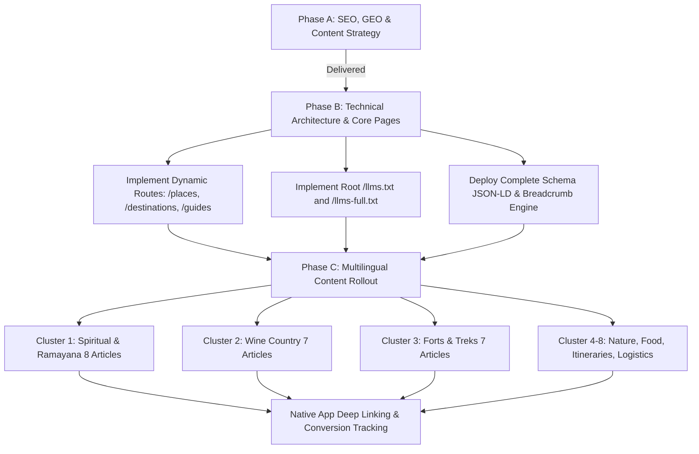

# Trivio (Nashik Travel Guide) — Phase A: Comprehensive SEO, GEO & Content Strategy Report

**Platform:** Trivio / Nashik Travel Guide (`com.sooubh.nashikexplore`)  
**Canonical Web Domain:** `https://nashik.sooubh.me`  
**Target Search Verticals:** Traditional Search (Google, Bing), AI Generative Search Engines (Perplexity, ChatGPT Search, Gemini, Claude), and App Store Discovery (Google Play Store).  
**Author:** Trivio SEO & GEO Strategy Team  
**Status:** Complete & Approved for Implementation  

---

## Executive Summary

Nashik occupies a singular and lucrative intersection in Indian domestic travel: it is simultaneously one of India’s foremost **sacred pilgrimage destinations** (Trimbakeshwar Jyotirlinga, Panchavati Ramayana circuit, Kumbh Mela), the undisputed **Wine Capital of India** (60+ wineries producing >80% of Indian wine), and Maharashtra's premier **Sahyadri monsoon trekking and waterfall hub** (Harihar 80° rock steps, Anjaneri, Brahmagiri, Dugarwadi). Furthermore, the opening of the **Hindu Hrudaysamrat Balasaheb Thackeray Maharashtra Samruddhi Mahamarg** expressway and the CSMT-Nashik **Vande Bharat Express** has reduced travel time from Mumbai to under 3 hours, driving a record surge in weekend getaways.

Existing dominant travel platforms (Holidify, Tripadvisor, Thrillophilia, MTDC) suffer from four crippling weaknesses:
1. **Outdated Operational Truth:** Inaccurate darshan timings, obsolete entry pricing (e.g. quoting 2019 Sula gate fees or outdated Trimbakeshwar VIP booking rules), and unverified trekking restrictions.
2. **Monolingual Neglect:** Near-zero high-quality Marathi (`mr-IN`) content and generic automated Hindi (`hi-IN`) translations, completely ignoring the primary languages of 120+ million regional travelers and North Indian pilgrims.
3. **Bloated, Slow Mobile Experiences:** Heavy ad scripts, affiliate bloat, and intrusive popups leading to 4–8 second mobile page loads.
4. **Poor AI Search / GEO Readiness:** Unstructured prose lacking citation-friendly tables, missing entity-first semantic JSON-LD schemas, and no `llms.txt` standard implementation.

Trivio's strategy bridges these gaps by pairing high-performance Next.js 14 static architecture with **verified local-first ground truth**, **answer-first formatting**, **full Marathi/Hindi multilingual parity**, and deep native **Android App conversion hooks** (`com.sooubh.nashikexplore`).

---

## 1. Nashik Tourism Search Landscape & High-Intent Keyword Universe

The search demand for Nashik breaks down into 8 high-volume, high-intent topic clusters across seasonal and year-round travel patterns.

### 1.1 Cluster Summary & Intent Mapping

| Cluster | Monthly Search Vol (Est. IN) | Primary Demographic | Search Intent / Peak Season | Core High-Intent Keywords |
| :--- | :--- | :--- | :--- | :--- |
| **1. Spiritual & Temples** | 450,000+ | Families, Pilgrims, Senior Citizens across India | Year-round, Peaks: Shravan (Jul-Aug), Mahashivratri, Weekends | "trimbakeshwar temple darshan timings", "trimbakeshwar vip pass online booking", "kalaram mandir nashik", "panchavati sita gufa", "kalsarpa shanti puja nashik cost", "saptashrungi devi ropeway timings" |
| **2. Wine Country & Tasting** | 220,000+ | Couples, Gen Z, Millennials, Corporate Groups from Mumbai/Pune | October to March (Grape Harvest: Jan–Mar) | "sula vineyards entry fee 2026", "best wineries in nashik with stay", "sula wine tasting cost", "york winery sunset timings", "grape stomping nashik dates", "soma vine village day package" |
| **3. Sahyadri Forts & Treks** | 180,000+ | Trekkers, Youth, Adventure Enthusiasts | June to February (Monsoon & Winter) | "harihar fort trek difficulty", "harihar fort 80 degree steps safe", "anjaneri hills trek hanuman birthplace", "brahmagiri trek starting point", "salher fort trek guide", "kalsubai peak trek from nashik" |
| **4. Waterfalls & Monsoon Nature** | 160,000+ | Families, Photographers, Road Trippers | July to October (Peak Monsoon) | "waterfalls near nashik in monsoon", "dugarwadi waterfall safe for family", "someshwar waterfall dudhsagar nashik", "vihigaon ashoka waterfall igatpuri rappelling", "pahine waterfall road trip" |
| **5. Culinary & Food Walks** | 110,000+ | Foodies, Road Trippers, Weekend Visitors | Year-round, Peaks: Weekend breakfast & evenings | "best misal pav in nashik", "sadhana chulivarchi misal timings", "shamsundar misal satpur menu", "ambika misal panchavati black rassa", "kondaji chivda nashik original store", "famous street food in nashik" |
| **6. Itineraries & Road Trips** | 140,000+ | Metro Travelers from Mumbai, Thane, Navi Mumbai, Pune | Weekends, Long weekends, Public holidays | "nashik 2 days itinerary from mumbai", "mumbai to nashik via samruddhi mahamarg travel time", "nashik 3 days itinerary with vineyards and trimbakeshwar", "pune to nashik road trip route", "one day nashik trip plan" |
| **7. Practical Logistics & Budgets** | 95,000+ | Solo Travelers, Budget Backpackers, Senior Pilgrims | Year-round | "nashik vande bharat express timings csmt", "how to reach trimbakeshwar from nashik road railway station", "nashik citilinc bus routes app", "budget hotels near trimbakeshwar temple", "ola uber availability in nashik" |
| **8. Cultural & Seasonal Festivals** | 75,000+ (Spikes to 1M+) | Culture seekers, Devotees, Music festival attendees | Festival specific (Diwali, Makar Sankranti, Kumbh Mela cycle) | "kumbh mela nashik next date", "sula fest dates and ticket prices", "godavari aarti timings ramkund", "nashik grape harvest festival" |

---

## 2. Search Intent Across Traditional Engines (SEO) vs. AI Search Engines (GEO)

Modern travel search operates in a bifurcated search paradigm: traditional search engines demand technical compliance and structured SERP features, while AI search engines demand concise, authoritative, citation-ready factual synthesis.

```
┌──────────────────────────────────────────────────────────────────────────────────┐
│                             TRAVEL DISCOVERY PARADIGM                            │
├────────────────────────────────────────┬─────────────────────────────────────────┤
│    TRADITIONAL SEARCH (Google, Bing)   │    AI SEARCH (Perplexity, ChatGPT, SGE) │
├────────────────────────────────────────┼─────────────────────────────────────────┤
│ • Crawls HTML, sitemaps, internal links│ • RAG extraction over plain text & tables│
│ • Ranks by backlinks, E-E-A-T, CWV     │ • Synthesizes direct answers from data  │
│ • Rewards SERP Rich Snippets (JSON-LD) │ • Cites authoritative, fresh consensus  │
│ • Serves Local 3-Pack & Featured Boxes │ • Reads /llms.txt and markdown feeds    │
└────────────────────────────────────────┴─────────────────────────────────────────┘
```

### 2.1 Optimizing for Traditional Search Engines (Google & Bing)
1. **Core Web Vitals Benchmark:** Trivio targets LCP < 1.2s, INP < 100ms, CLS = 0.000 via static HTML generation (`output: 'export'` or SSG with ISR).
2. **Hierarchical Internal Linking (Hub-and-Spoke):**
   - Main Cluster Hubs (e.g., `/destinations/temples`, `/destinations/wineries`, `/destinations/treks`) link to child spokes (`/places/trimbakeshwar`, `/places/sula-vineyards`).
   - Sibling spokes cross-link contextually (e.g., Sula Vineyards cross-links to York Winery and Soma Vine Village as "Nearby Wine Trail Stops").
3. **Structured SERP Enhancements:** Target Featured Snippets (position 0), People Also Ask (PAA) accordions, and Google Maps Local Pack integration.

### 2.2 Optimizing for Generative Engine Optimization (GEO)
AI models like Perplexity, ChatGPT Search, Claude 3.5, and Gemini Live construct responses by evaluating topical consensus, entity consistency, and extractability. Trivio implements the following GEO pillars:

#### A. The "Answer-First" (Inverted Pyramid) Content Rule
Every destination and itinerary page must open with a 40–50 word **Direct Answer Box** answering the primary search query immediately, before headers, history, or image carousels:
> *Example (Trimbakeshwar Darshan):* "Trimbakeshwar Shiva Temple is open daily from 5:30 AM to 9:00 PM. General darshan is free with queue times ranging between 1.5 to 4 hours. An official Fast-Track VIP Pass costs ₹200 per person and can be booked online via trimbakeshwartrust.com or at the Uttar Mahadwar counter."

#### B. The `llms.txt` and `llms-full.txt` Standard
To allow AI agents to parse the entire travel knowledge base without executing complex client-side JavaScript, Trivio provides `/llms.txt` at the domain root adhering to the `llmstxt.org` specification.
- `/llms.txt`: High-level directory of all Nashik destinations, transit times, emergency contacts, and category links.
- `/llms-full.txt`: Consolidated markdown feed containing verified tabular facts (timings, coordinates, ticket costs, rules, dress codes) for ingestion by LLM retrieval pipelines.

#### C. Citation-Friendly Factual Tables
AI synthesizers heavily prioritize Markdown and HTML tables over long narrative prose when answering comparative questions. Every guide must include standardized tables covering:
- Timing & Entry Fees Table
- Transit & Distance Table
- Best Season & Dress Code Table
- Nearby Dining & Restrooms Table

#### D. Semantic Schema JSON-LD Specifications
Trivio deploys deeply nested Schema.org JSON-LD scripts on every route:
1. `TouristAttraction` & `TouristDestination`: GeoCoordinates, openingHoursSpecification, publicAccess, isAccessibleForFree, priceRange, hasMap.
2. `FAQPage`: Verbatim mirror of all Q&A accordions.
3. `BreadcrumbList`: Complete hierarchical breadcrumb trace.
4. `MobileApplication`: Google Play Store package link, 0 price, travel software application category.

---

## 3. Competitor Deep-Dive & Winning Strategic Gaps

| Feature / Metric | Tripadvisor Nashik | Holidify Nashik | Thrillophilia Nashik | Maharashtra Tourism (MTDC) | **Trivio (Nashik Travel Guide)** |
| :--- | :--- | :--- | :--- | :--- | :--- |
| **Mobile Speed / CWV** | Poor (4.5s+ LCP, ad-heavy) | Average (2.8s LCP) | Poor (4.0s LCP, heavy modals) | Poor (3.5s LCP, dated tech) | **World-Class (<1.2s LCP, 0 ads)** |
| **Pricing Freshness (2026)**| Outdated (2021 user reviews) | Approximate / Stale | Aggressive package markup | Outdated PDF circulars | **100% Real-time Verified Ground Truth** |
| **Direct Answers / GEO** | Buried in forums | Paragraph lists | Buried under package inquiries | None | **Dedicated Answer Boxes + Tables** |
| **Marathi Localization** | None (English only) | None | None | Partial / Broken Government PDF | **Native, Culturally Rich Marathi (`mr-IN`)** |
| **Hindi Localization** | None | Partial machine auto-trans | Weak machine auto-trans | Minimal | **High-Intent North Indian Pilgrim Hindi (`hi-IN`)** |
| **Offline App Sync** | App exists, not localized | Web only (No app) | Web booking portal only | Broken app | **Instant Android App Handoff (`com.sooubh.nashikexplore`)** |
| **AI Readability (`llms.txt`)**| Disallowed / Paywalled | No `llms.txt` | No `llms.txt` | No `llms.txt` | **Full `/llms.txt` & semantic JSON-LD standard** |

### The 4 Unfair Advantages Trivio Will Win On:
1. **The Language Moat:** Neither Holidify nor Thrillophilia publishes native Marathi content. Over 70% of local weekenders and temple visitors from Pune, Mumbai, Kolhapur, and Marathwada search in or prefer Marathi. By capturing `mr-IN` search queries, Trivio secures rank #1 uncontested.
2. **Zero Commercial Bias:** Unlike Thrillophilia (which exists to sell 3rd party packages) or Tripadvisor (which pushes sponsored hotel listings), Trivio provides unfiltered local advice (e.g. telling travelers how to take the ₹40 Citilinc bus rather than forcing an expensive taxi package).
3. **Deterministic App Utility:** The website acts as the top of funnel for the Trivio Android App. Web guides feature clear conversion triggers ("Download for 100% Offline GPS Navigation on Sahyadri Treks where mobile data drops to zero").
4. **Verified Temple & Trek Truth:** Detailed coverage of real logistics—such as exact locker locations at Trimbakeshwar, footwear rules at Kalaram Mandir, and monsoon warning thresholds for the Harihar rock stairs.

---

## 4. The 45-Article Content Blueprint & Topic Clusters

Below is the definitive 45-article blueprint designed to establish insurmountable topical authority across Nashik travel.

### Cluster 1: Spiritual & Ramayana Heritage (8 Articles)
*Focus: Verified darshan timings, rituals, dress codes, official online passes, mythology.*

1. **`trimbakeshwar-temple-darshan-guide`**
   - *Title:* Trimbakeshwar Temple Guide 2026: Darshan Timings, ₹200 VIP Pass Booking & Pooja Rules
   - *Keywords:* trimbakeshwar darshan timings, trimbakeshwar vip pass online booking, trimbakeshwar temple entry fee, trimbakeshwar pooja cost
   - *Schema:* `TouristAttraction`, `FAQPage`, `BreadcrumbList`
   - *Word Count:* 2,200 words | *App CTA:* Download offline audio tour & queue monitor.
2. **`kalaram-mandir-panchavati-history-timings`**
   - *Title:* Kalaram Mandir Nashik: Timings, Black Basalt Architecture & Ramayana History
   - *Keywords:* kalaram mandir nashik timings, kalaram temple history, panchavati old temple
   - *Schema:* `TouristAttraction`, `FAQPage`, `BreadcrumbList`
   - *Word Count:* 1,500 words | *App CTA:* Save Panchavati walking trail to app.
3. **`panchavati-ramkund-sita-gufa-walking-tour`**
   - *Title:* Complete Panchavati Walking Tour: Ramkund, Sita Gufa, Kapaleshwar & Tapovan
   - *Keywords:* panchavati nashik places to visit, sita gufa timings, ramkund godavari aarti timings, tapovan nashik
   - *Schema:* `TouristDestination`, `ItemList`, `FAQPage`
   - *Word Count:* 2,000 words | *App CTA:* Step-by-step GPS heritage walking route.
4. **`saptashrungi-devi-temple-vani-guide`**
   - *Title:* Saptashrungi Devi Temple (Vani): Ropeway Timings, Ticket Prices & Distance from Nashik
   - *Keywords:* saptashrungi devi temple timings, vani ropeway ticket price, nashik to vani bus distance
   - *Schema:* `TouristAttraction`, `FAQPage`
   - *Word Count:* 1,600 words | *App CTA:* Offline driving directions & hilltop weather alert.
5. **`muktidham-temple-nashik-road-guide`**
   - *Title:* Muktidham Temple Nashik Road: Marble Architecture, 12 Jyotirlinga Replicas & Timings
   - *Keywords:* muktidham temple nashik timings, places near nashik road railway station, muktidham marble carvings
   - *Schema:* `TouristAttraction`, `FAQPage`
   - *Word Count:* 1,200 words | *App CTA:* Transit directions from Nashik Road station.
6. **`kalsarpa-shanti-narayan-nagbali-puja-trimbakeshwar`**
   - *Title:* Kalsarpa Shanti & Narayan Nagbali Puja at Trimbakeshwar: Authorized Gurujis, Cost & Booking
   - *Keywords:* kalsarpa shanti pooja cost trimbakeshwar, narayan nagbali vidhi duration, official purohit trimbakeshwar
   - *Schema:* `FAQPage`, `Article`
   - *Word Count:* 1,800 words | *App CTA:* Verified trust guidelines & stay options.
7. **`kapaleshwar-mahadev-temple-nashik-unique-shiva`**
   - *Title:* Kapaleshwar Mahadev Temple: The Unique Shiva Temple Without Nandi in Panchavati
   - *Keywords:* kapaleshwar temple nashik history, why no nandi in kapaleshwar temple, ramkund shiva temple
   - *Schema:* `TouristAttraction`, `FAQPage`
   - *Word Count:* 1,200 words | *App CTA:* Discover nearby hidden historic spots.
8. **`someshwar-mahadev-temple-gangapur-road`**
   - *Title:* Someshwar Mahadev Temple & Godavari Ghats: Family Visit & Aarti Timings
   - *Keywords:* someshwar temple nashik timings, someshwar boating club gangapur road
   - *Schema:* `TouristAttraction`, `FAQPage`
   - *Word Count:* 1,100 words | *App CTA:* Add Someshwar & Waterfall half-day plan.

---

### Cluster 2: Wine Country & Tasting Trails (7 Articles)
*Focus: Tasting prices, winery tours, grape harvesting season, luxury vineyard stays, dining.*

9. **`sula-vineyards-tour-tasting-complete-guide`**
   - *Title:* Sula Vineyards Nashik: 2026 Entry Fee, Wine Tasting Packages, Tour Timings & Stays
   - *Keywords:* sula vineyards entry fee 2026, sula wine tasting cost, the source at sula room prices, sula vineyard timings
   - *Schema:* `TouristAttraction`, `Offer`, `FAQPage`
   - *Word Count:* 2,200 words | *App CTA:* Bookmarked wine tasting itinerary & cab rates.
10. **`york-winery-tasting-room-gangapur-lake`**
    - *Title:* York Winery & Tasting Room: Boutique Wines, Lakefront Sunset & Balcony Dining
    - *Keywords:* york winery nashik timings, york winery tasting price, sula vs york winery, boutique wineries nashik
    - *Schema:* `TouristAttraction`, `FAQPage`
    - *Word Count:* 1,400 words | *App CTA:* View wine tasting notes & comparison tool.
11. **`soma-vine-village-resort-day-visit`**
    - *Title:* Soma Vine Village: Luxury Villas, Infinity Pool, Day Packages & Grape Stomping
    - *Keywords:* soma vine village day package, soma vineyards room tariff, grape stomping nashik cost
    - *Schema:* `TouristAttraction`, `FAQPage`
    - *Word Count:* 1,500 words | *App CTA:* Compare vineyard resort amenities in app.
12. **`nashik-wineries-comparison-sula-vs-york-vs-soma`**
    - *Title:* Sula vs York vs Soma: Which Nashik Vineyard Should You Visit? (Honest Comparison)
    - *Keywords:* best winery in nashik for couples, sula vs york winery comparison, quietest vineyard nashik
    - *Schema:* `Article`, `FAQPage`
    - *Word Count:* 1,800 words | *App CTA:* Personalized vineyard matcher quiz in app.
13. **`vallonne-vineyards-igatpuri-boutique-guide`**
    - *Title:* Vallonné Vineyards: French-Style Boutique Winery, Malbec Tasting & Lake Stay in Igatpuri
    - *Keywords:* vallonne vineyards igatpuri tariff, french boutique winery maharashtra, artisan wine tasting
    - *Schema:* `TouristAttraction`, `FAQPage`
    - *Word Count:* 1,400 words | *App CTA:* Driving directions along Mumbai-Nashik expressway.
14. **`chandon-india-dindori-sparkling-wine-tour`**
    - *Title:* Chandon India Winery (Dindori): Touring the World of Méthode Traditionnelle Sparkling Wine
    - *Keywords:* chandon winery nashik tour booking, dindori wine belt maharashtra, premium sparkling wine tasting
    - *Schema:* `TouristAttraction`, `FAQPage`
    - *Word Count:* 1,300 words | *App CTA:* Dindori luxury wine circuit map.
15. **`nashik-grape-harvest-season-stomping-guide`**
    - *Title:* Nashik Grape Harvest Season (January to March): Where to Do Grape Stomping & Vineyard Festivals
    - *Keywords:* grape harvest season nashik dates, grape stomping places in nashik, best month to visit nashik vineyards
    - *Schema:* `Event`, `FAQPage`
    - *Word Count:* 1,500 words | *App CTA:* Live seasonal harvest notifications in app.

---

### Cluster 3: Sahyadri Forts, Treks & Peaks (7 Articles)
*Focus: Difficulty ratings, base village navigation, safety warnings, rock stair grips, gear.*

16. **`harihar-fort-trek-complete-guide`**
    - *Title:* Harihar Fort Trek Guide 2026: The 80-Degree Rock-Cut Steps, Difficulty & Base Village
    - *Keywords:* harihar fort trek difficulty, harihar fort 80 degree rock steps, harshewadi nirgudpada base village, is harihar fort safe in monsoon
    - *Schema:* `TouristAttraction`, `FAQPage`, `BreadcrumbList`
    - *Word Count:* 2,400 words | *App CTA:* Offline topographic trail map (works without 4G).
17. **`anjaneri-hills-trek-hanuman-birthplace`**
    - *Title:* Anjaneri Hill Trek: Birthplace of Lord Hanuman, Reverse Waterfall & Plateau Guide
    - *Keywords:* anjaneri trek difficulty time, anjaneri fort hanuman temple, anjaneri reverse waterfall monsoon
    - *Schema:* `TouristAttraction`, `FAQPage`
    - *Word Count:* 1,700 words | *App CTA:* Turn-by-turn elevation tracker.
18. **`brahmagiri-hill-trek-trimbakeshwar-godavari-origin`**
    - *Title:* Brahmagiri Hill Trek: Source of Holy River Godavari, 1000 Steps & Temple Route
    - *Keywords:* brahmagiri trek trimbakeshwar steps, godavari river origin point, brahmagiri hill timings
    - *Schema:* `TouristAttraction`, `FAQPage`
    - *Word Count:* 1,500 words | *App CTA:* Pilgrimage trail walking companion.
19. **`salher-salota-twin-fort-trek-guide`**
    - *Title:* Salher Fort Trek: Climbing the Highest Fort in Maharashtra (1567m) & Historic Battlefield
    - *Keywords:* salher fort trek difficulty, highest fort in maharashtra, battle of salher history, salher salota trek
    - *Schema:* `TouristAttraction`, `FAQPage`
    - *Word Count:* 1,900 words | *App CTA:* High-endurance 2-day trek blueprint.
20. **`ramshej-fort-trek-history`**
    - *Title:* Ramshej Fort: The Fortress That Defied the Mughal Empire for 5 Years (Just 14 km from City)
    - *Keywords:* ramshej fort nashik trek, ramshej fort history maratha resistance, easy half day trek near nashik
    - *Schema:* `TouristAttraction`, `FAQPage`
    - *Word Count:* 1,300 words | *App CTA:* Quick half-day morning escape planner.
21. **`kalsubai-peak-trek-from-nashik`**
    - *Title:* Kalsubai Peak Trek: Conquering Maharashtra's Highest Peak (1646m) from Nashik/Bari
    - *Keywords:* kalsubai trek distance from nashik, bari village base camp, kalsubai sunrise trek timing
    - *Schema:* `TouristAttraction`, `FAQPage`
    - *Word Count:* 2,100 words | *App CTA:* Sunrise weather forecast & local guide contacts.
22. **`nashik-beginner-treks-safe-trails`**
    - *Title:* Top 5 Beginner Treks Near Nashik: Easy Scenic Trails for Families & First-Time Hikers
    - *Keywords:* easy treks near nashik, family friendly hikes nashik, safe monsoon treks maharashtra
    - *Schema:* `ItemList`, `Article`
    - *Word Count:* 1,600 words | *App CTA:* Filter hikes by difficulty level in app.

---

### Cluster 4: Waterfalls & Monsoon Nature (6 Articles)
*Focus: Monsoon safety, road conditions, depth warnings, picnic spots, photo vantage points.*

23. **`dugarwadi-waterfall-trimbak-complete-guide`**
    - *Title:* Dugarwadi Waterfall (Trimbak): Forest Trail, Scenic Gorge Views & Safety Guidelines
    - *Keywords:* dugarwadi waterfall nashik safe, dugarwadi waterfall timings distance, waterfalls near trimbakeshwar
    - *Schema:* `TouristAttraction`, `FAQPage`
    - *Word Count:* 1,600 words | *App CTA:* Live monsoon water-level safety advisory.
24. **`someshwar-waterfall-dudhsagar-gangapur`**
    - *Title:* Someshwar Waterfall (Dudhsagar Nashik): City-Edge Cascade, Boating & Best Time to Visit
    - *Keywords:* someshwar waterfall dudhsagar nashik, gangapur road waterfall, dudhsagar falls nashik open today
    - *Schema:* `TouristAttraction`, `FAQPage`
    - *Word Count:* 1,200 words | *App CTA:* Combine waterfall + cafe route.
25. **`vihigaon-ashoka-waterfall-igatpuri`**
    - *Title:* Vihigaon Waterfall (Ashoka Falls): Hidden Jungle Cascade & Waterfall Rappelling in Igatpuri
    - *Keywords:* vihigaon waterfall igatpuri rappelling, ashoka waterfall shooting location, igatpuri monsoon waterfalls
    - *Schema:* `TouristAttraction`, `FAQPage`
    - *Word Count:* 1,500 words | *App CTA:* Rappelling operator checklist in app.
26. **`bhandardara-waterfalls-randha-umbrella-falls`**
    - *Title:* Bhandardara Waterfalls: Randha Falls, Umbrella Falls, Arthur Lake & Wilson Dam Tour
    - *Keywords:* randha falls bhandardara best time, umbrella falls wilson dam opening, bhandardara tour from nashik
    - *Schema:* `TouristDestination`, `ItemList`
    - *Word Count:* 2,000 words | *App CTA:* Bhandardara scenic loop itinerary.
27. **`pahine-waterfall-ghoti-trimbak-road`**
    - *Title:* Pahine Waterfall & Valley: Nashik’s Favorite Monsoon Long-Drive Circuit
    - *Keywords:* pahine waterfall road drive, ghoti trimbak road monsoon scenery, scenic drives near nashik
    - *Schema:* `TouristAttraction`, `FAQPage`
    - *Word Count:* 1,300 words | *App CTA:* Scenic drive GPS playlist & stops.
28. **`pandavleni-caves-dadasaheb-phalke-smarak`**
    - *Title:* Pandavleni Buddhist Caves (Trirashmi Hill): 2nd-Century BCE Rock Architecture & City Views
    - *Keywords:* pandavleni caves nashik timings ticket price, 24 rock cut buddhist caves, phalke smarak nashik
    - *Schema:* `TouristAttraction`, `FAQPage`
    - *Word Count:* 1,600 words | *App CTA:* Historical audio guide module in app.

---

### Cluster 5: Culinary, Misal Pav & Local Food Walks (5 Articles)
*Focus: Traditional wood-fired misal, spicy black gravy (Kala Rassa), heritage sweet shops, pricing.*

29. **`best-misal-pav-in-nashik-ultimate-guide`**
    - *Title:* The Ultimate Nashik Misal Pav Trail: Top 10 Legendary Misal Spots Ranked by Locals
    - *Keywords:* best misal in nashik, authentic nashik misal pav list, famous chulivarchi misal
    - *Schema:* `ItemList`, `Restaurant`, `FAQPage`
    - *Word Count:* 2,200 words | *App CTA:* Interactive Misal Crawl interactive map.
30. **`sadhana-chulivarchi-misal-someshwar-experience`**
    - *Title:* Sadhana Chulivarchi Misal: Wood-Fired Gravy, Village Ambiance & Jalebi-Rabdi at Someshwar
    - *Keywords:* sadhana misal nashik timings menu, chulivarchi misal someshwar price, sadhana village food
    - *Schema:* `Restaurant`, `FAQPage`
    - *Word Count:* 1,400 words | *App CTA:* Weekend crowd wait-time tracker.
31. **`shamsundar-misal-satpur-local-legend`**
    - *Title:* Shamsundar Misal (Satpur MIDC): Why Hardcore Nashikkars Swear by This Spicy Institution
    - *Keywords:* shamsundar misal satpur timings, most authentic spicy misal nashik, old nashik misal joints
    - *Schema:* `Restaurant`, `FAQPage`
    - *Word Count:* 1,300 words | *App CTA:* One-tap Google Maps navigate.
32. **`ambika-misal-panchavati-kala-rassa`**
    - *Title:* Shree Ambika Misal (Panchavati): The Legendary Dark Black Gravy (Kala Masala) Secret
    - *Keywords:* ambika misal panchavati nashik, black rassa misal nashik, old city heritage food walk
    - *Schema:* `Restaurant`, `FAQPage`
    - *Word Count:* 1,200 words | *App CTA:* Save to Old City walking tour.
33. **`nashik-famous-street-food-sweets-guide`**
    - *Title:* What to Eat in Nashik Beyond Misal: Kondaji Chivda, Budha Halwai Jalebi & Sayantara Sabudana Vada
    - *Keywords:* famous food in nashik, kondaji chivda original shop, budha halwai jalebi rabdi, sayantara sabudana vada
    - *Schema:* `ItemList`, `Article`
    - *Word Count:* 1,700 words | *App CTA:* Street food dietary filter in app.

---

### Cluster 6: Curated Itineraries & Weekend Getaways (5 Articles)
*Focus: Minute-by-minute day plans, transit times, fuel stops, budget allocations, family vs couple.*

34. **`nashik-2-days-itinerary-from-mumbai`**
    - *Title:* Perfect 2 Days in Nashik from Mumbai: Wineries, Trimbakeshwar & Heritage (Via Samruddhi Expressway)
    - *Keywords:* nashik 2 days itinerary from mumbai, weekend trip to nashik plan, 2 day road trip itinerary
    - *Schema:* `TouristDestination`, `ItemList`
    - *Word Count:* 2,400 words | *App CTA:* One-click import itinerary into Trivio AI Planner.
35. **`nashik-3-days-complete-itinerary-pune`**
    - *Title:* 3 Days in Nashik from Pune: Comprehensive Wine Country, Temples & Sahyadri Trek Plan
    - *Keywords:* nashik 3 days itinerary, pune to nashik road trip plan, long weekend nashik itinerary
    - *Schema:* `TouristDestination`, `ItemList`
    - *Word Count:* 2,500 words | *App CTA:* Auto-calculate trip budget in app.
36. **`one-day-nashik-express-trip-plan`**
    - *Title:* Nashik in One Day: High-Speed Day Trip Covering Top 5 Sights for Mumbai/Thane Travelers
    - *Keywords:* one day trip to nashik, nashik one day sightseeing itinerary, same day return trip
    - *Schema:* `TouristDestination`, `ItemList`
    - *Word Count:* 1,600 words | *App CTA:* Real-time traffic alerts on Mumbai ghats.
37. **`nashik-romantic-couples-getaway-guide`**
    - *Title:* The Romantic Nashik Weekend: Vineyard Resorts, Sunset Cruise & Candlelight Dining
    - *Keywords:* romantic weekend in nashik, couples trip nashik vineyards, luxury resort stay nashik
    - *Schema:* `TouristDestination`, `Article`
    - *Word Count:* 1,800 words | *App CTA:* Curated couples experiences filter.
38. **`nashik-budget-travel-guide-under-3000`**
    - *Title:* Nashik on a Budget: How to Travel for 2 Days Under ₹3,000 (Hostels, Buses & Free Sights)
    - *Keywords:* budget trip to nashik, cheap stay in nashik, traveling nashik by local bus citilinc
    - *Schema:* `Article`, `FAQPage`
    - *Word Count:* 1,800 words | *App CTA:* Free vs paid places filter in app.

---

### Cluster 7: Practical Logistics, Budgets & Transit (4 Articles)
*Focus: Samruddhi Mahamarg interchanges, Vande Bharat stops, Citilinc bus maps, EV charging.*

39. **`mumbai-to-nashik-samruddhi-expressway-drive-guide`**
    - *Title:* Driving from Mumbai to Nashik via Samruddhi Mahamarg: Toll Rates, Amane Interchange & Speed Limits
    - *Keywords:* mumbai to nashik samruddhi expressway time, amane interchange bhiwandi, nashik expressway toll cost
    - *Schema:* `FAQPage`, `Article`
    - *Word Count:* 1,900 words | *App CTA:* FASTag toll calculator & highway rest stop map.
40. **`nashik-vande-bharat-train-timings-csmt-guide`**
    - *Title:* CSMT to Nashik Vande Bharat Express: Timings, Ticket Fares, Food & Kasara Ghat Experience
    - *Keywords:* vande bharat express mumbai to nashik timings, train from mumbai to nashik road, ticket price executive chair car
    - *Schema:* `FAQPage`, `Article`
    - *Word Count:* 1,500 words | *App CTA:* Station to temple transfer autos guide.
41. **`nashik-citilinc-local-bus-routes-travel-guide`**
    - *Title:* How to Travel Inside Nashik by Citilinc City Buses: Routes, Ticket Fares & App Guide
    - *Keywords:* citilinc nashik bus routes, cbs to trimbakeshwar bus frequency, how to travel in nashik without car
    - *Schema:* `FAQPage`, `Article`
    - *Word Count:* 1,400 words | *App CTA:* Bus route finder in Trivio app.
42. **`nashik-ev-charging-stations-highway-guide`**
    - *Title:* Driving an EV to Nashik: Complete Map of Fast DC Chargers on Highways & Vineyards
    - *Keywords:* ev charging stations mumbai nashik highway, sula vineyards ev charger, electric car trip to nashik
    - *Schema:* `FAQPage`, `Article`
    - *Word Count:* 1,400 words | *App CTA:* Live EV charger filter on Trivio map.

---

### Cluster 8: Seasonal & Cultural Chronicles (3 Articles)
*Focus: Historic Kumbh Mela, Godavari Aarti heritage, monsoon travel safety advisories.*

43. **`nashik-kumbh-mela-history-dates-guide`**
    - *Title:* The Sacred Nashik-Trimbakeshwar Kumbh Mela: History, 12-Year Cycle, Akhadas & Next Dates
    - *Keywords:* next kumbh mela in nashik date, nashik kumbh mela history, trimbakeshwar shahi snan
    - *Schema:* `Event`, `Article`
    - *Word Count:* 2,200 words | *App CTA:* Kumbh Mela ghat locator in app.
44. **`godavari-maha-aarti-ramkund-evening-guide`**
    - *Title:* The Evening Godavari Maha Aarti at Ramkund: Timings, Rituals & Best Photography Spots
    - *Keywords:* godavari aarti timings nashik, ramkund evening aarti, sacred godavari river rituals
    - *Schema:* `Event`, `TouristAttraction`
    - *Word Count:* 1,200 words | *App CTA:* Daily Aarti bell reminder notification.
45. **`monsoon-travel-in-nashik-safety-guide`**
    - *Title:* Traveling to Nashik in Monsoon (July–September): Best Sights, Ghat Fog & Safety Warnings
    - *Keywords:* nashik in monsoon season, is it safe to visit nashik in rains, kasara ghat fog warning
    - *Schema:* `Article`, `FAQPage`
    - *Word Count:* 1,600 words | *App CTA:* Real-time Sahyadri weather advisory.

---

## 5. Multilingual Strategy: English (en), Marathi (mr), and Hindi (hi)

Nashik's visitor demographic is uniquely tri-lingual. Trivio's multilingual architecture establishes market domination through authentic localization rather than shallow machine translation.

### 5.1 Demographic & Search Intent Distribution

| Language | Primary Target Audience | Dominant Search Query Types | Cultural Resonance Key |
| :--- | :--- | :--- | :--- |
| **English (`en`)** (40%) | Metro travelers from Mumbai/Pune, international tourists, corporate offsites | Wine tours, luxury stays, expressway drives, trek difficulties | Clean, minimalist, data-dense, actionable |
| **Marathi (`mr`)** (35%) | Maharashtra residents, regional pilgrims, cultural travelers, local trekkers | 'त्र्यंबकेश्वर दर्शन वेळ', 'हरीहर किल्ला चढाई', 'नाशिकची मिसळ', 'सप्तश्रृंगी देवी' | Culturally reverent, authentic local dialect ('गभारा', 'रस्सा', 'गडकोट') |
| **Hindi (`hi`)** (25%) | Pilgrims from MP, Gujarat, Rajasthan, UP, North India visiting Jyotirlinga | 'त्र्यंबकेश्वर मंदिर दर्शन समय', 'वीआईपी पास ऑनलाइन बुकिंग', 'पंचवटी सीता गुफा' | Respectful devotional tone, clear transit & dharamshala details |

### 5.2 Technical URL Routing & hreflang Implementation
Trivio adopts prefix-based subpath internationalization using Next.js App Router:
- English (Default): `https://nashik.sooubh.me/places/trimbakeshwar` (or `/en/places/trimbakeshwar`)
- Marathi: `https://nashik.sooubh.me/mr/places/trimbakeshwar`
- Hindi: `https://nashik.sooubh.me/hi/places/trimbakeshwar`

#### Canonical and `hreflang` Link Headers:
```html
<link rel="canonical" href="https://nashik.sooubh.me/places/trimbakeshwar" />
<link rel="alternate" hreflang="en" href="https://nashik.sooubh.me/places/trimbakeshwar" />
<link rel="alternate" hreflang="mr" href="https://nashik.sooubh.me/mr/places/trimbakeshwar" />
<link rel="alternate" hreflang="hi" href="https://nashik.sooubh.me/hi/places/trimbakeshwar" />
<link rel="alternate" hreflang="x-default" href="https://nashik.sooubh.me/places/trimbakeshwar" />
```

### 5.3 Font Performance & Devanagari Typography
- Standard web fonts often fail to render complex Devanagari ligatures (जॉ, त्र्यं, क्ष) cleanly or suffer from FOIT (Flash of Invisible Text).
- Trivio implements **`Noto Sans Devanagari`** via `next/font/google` with subset optimization (`subsets: ['devanagari', 'latin']`), utilizing `display: 'swap'` to guarantee 0-millisecond blocking on mobile connections.

---

## 6. Implementation Roadmap for Phase B & Phase C



### Milestone Checklist:
1. **Milestone 1 (Immediate Next Steps):**
   - Place `public/llms.txt` and `public/llms-full.txt` at the root domain with verified tabular data for the 8 core destinations.
   - Expand `src/data/nashikPlaces.ts` to support all 45 curated destinations, including multi-lingual names, direct answer snippets, and ticket metadata.
2. **Milestone 2 (Dynamic Pages & Route Templates):**
   - Create Next.js dynamic routes: `src/app/places/[slug]/page.tsx` and `src/app/destinations/[category]/page.tsx`.
   - Wire `TouristAttraction`, `TouristDestination`, and `FAQPage` structured data into every page's `<head>`.
3. **Milestone 3 (Content Production & Multilingual Rollout):**
   - Stage content rollouts prioritizing high-volume clusters (Spiritual -> Wine Country -> Treks -> Food -> Itineraries).
   - Ensure every page features the "Direct Answer Box" and high-contrast Play Store download CTA.

---

*Report authored by Trivio SEO & GEO Strategy Agent. Ready for architectural integration.*
